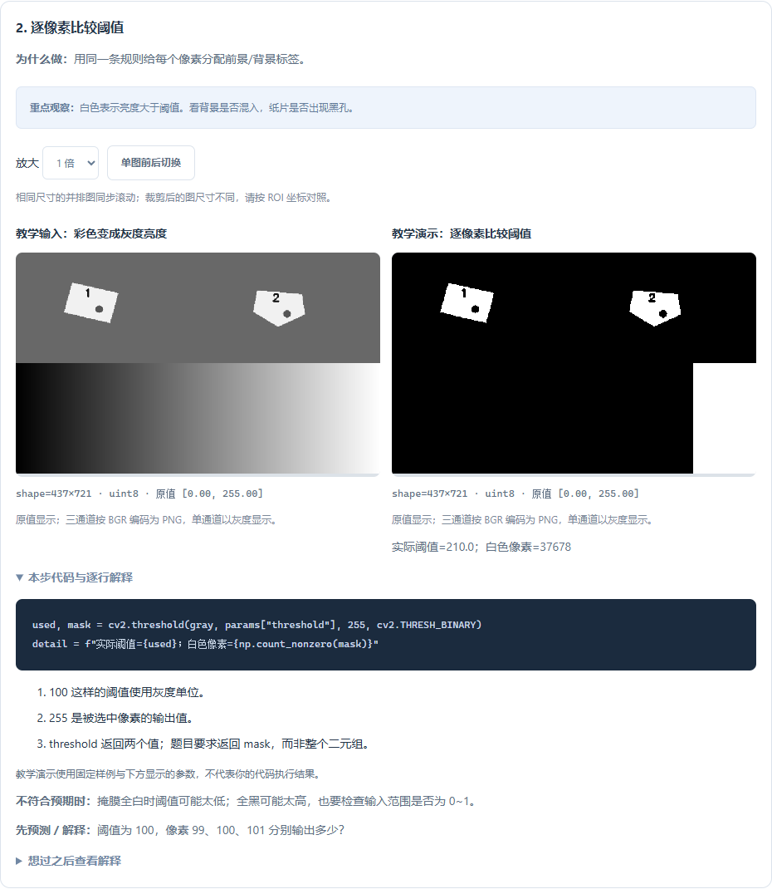
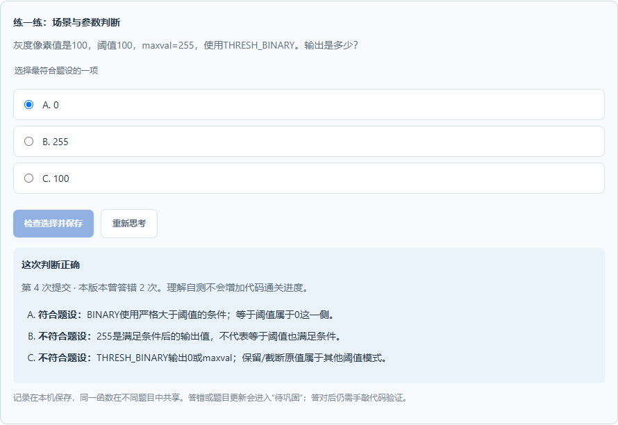
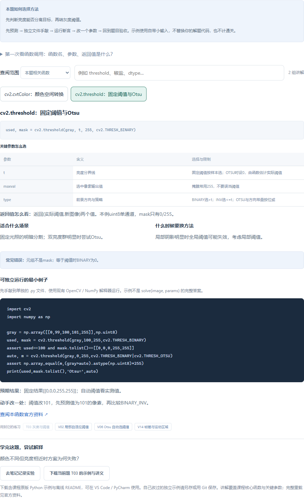
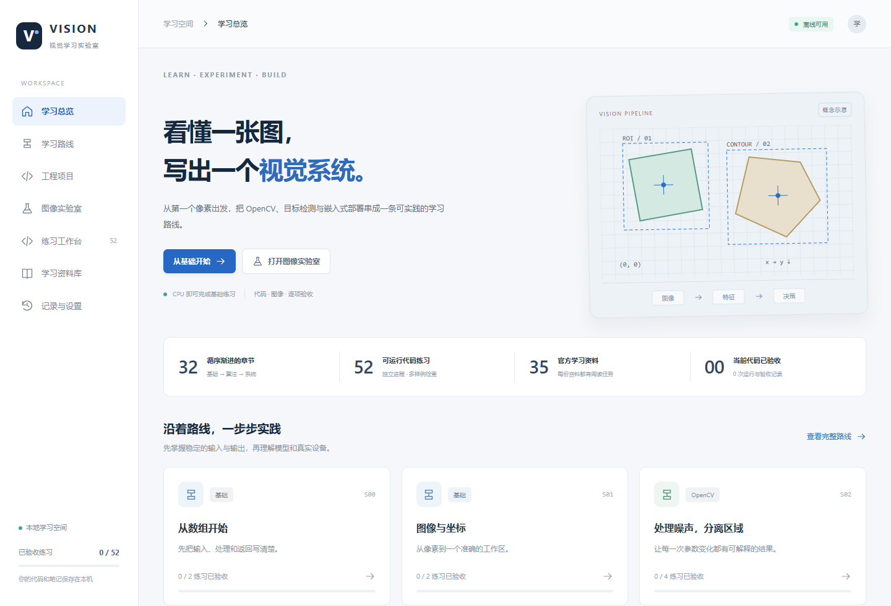
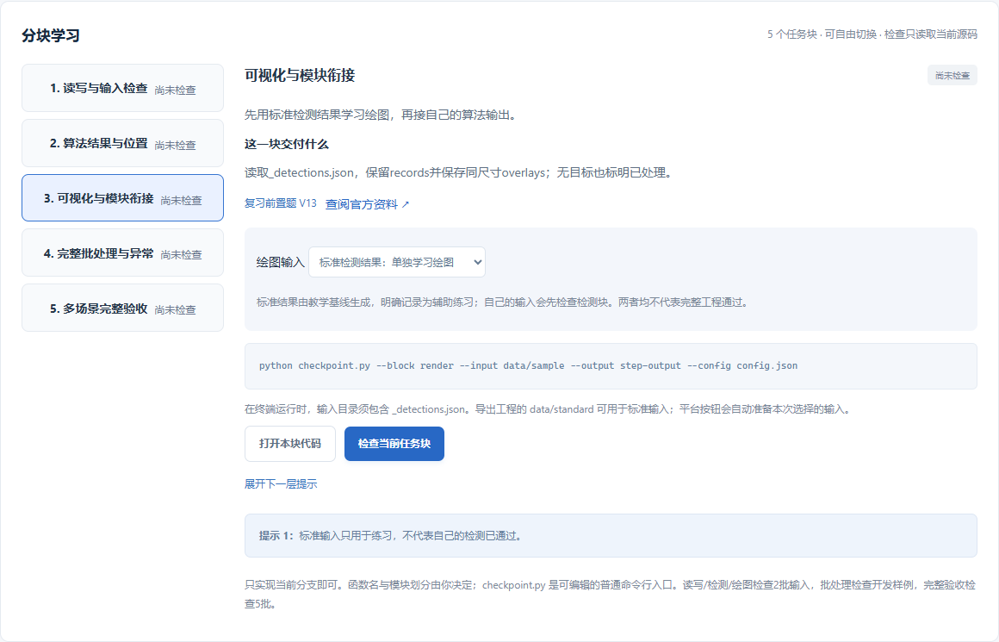
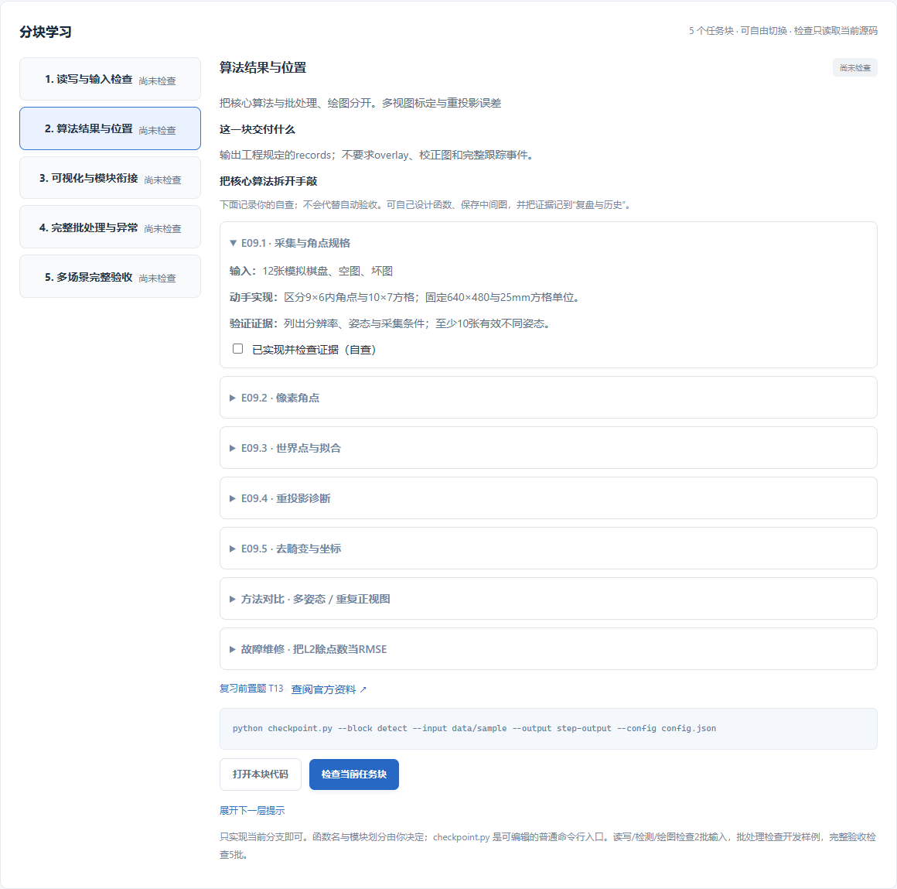

# Vision Learning Hub · 视觉学习实验室

**0.9.0：每一步都看清楚。** 首批 8 道基础题增加 18 个逐步图解：场景、处理前后图、代码与逐行解释、观察方向、错误排查和预测问题。支持同图缩放对照、27 组参数配置、默认参数比较、分步手敲与真实结果导入。观察笔记和学习位置本地记忆，正式题目成绩独立。详见[逐步图解指南](VisionLearningHub/docs/逐步图解学习指南-0.9.0.md)。

**0.8.1：把会读函数变成会选方法。** 新增40道场景/参数理解自测，每个选项都有解释；本机保存提交次数和答错次数，支持跨题共享、待巩固筛选、备份恢复和题目更新后的重新判断。自测与代码验收进度分开。详见[使用指南](VisionLearningHub/docs/函数理解自测-0.8.1.md)。

0.8.0 为现有 **44 道基础题**增加“函数与场景”：**40 组函数/算法组件讲解**，包含关键参数、输入输出类型、适用与不适用场景、常见错误、可独立运行的断言示例、改参实验和相关题目跳转。可按函数名或场景搜索，下载本题 Python 示例与离线讲义；VS Code 可直接打开独立示例，已有修改保留。阅读与示例运行不计通关。

E07 新增 ORB 特征、Hamming 筛选、RANSAC 定位、拟合对比、匹配器维修五个可自动检查的细分块，现有工程共 **50 个任务块**。匹配与定位可用标准或自己的上游结果；两类记录分开，完整工程仍需正式验收。

[函数学习指南与推荐顺序](VisionLearningHub/docs/函数学习指南-0.8.0.md)

**从读懂图像，到独立交付一个能运行、能验证的视觉工程。**

面向视觉初学者的本地学习平台：阅读课程、手敲 Python、观察处理结果，再通过多场景验收检验实现。支持网页版和可选安装的 VS Code 扩展，使用 OpenCV、NumPy 和普通 Python 模块组织代码。

[](https://github.com/CaoYujie-code/VisionLearningHub/actions/workflows/check.yml)

[下载安装包](https://github.com/CaoYujie-code/VisionLearningHub/releases) · [双模式学习指南](VisionLearningHub/docs/双模式工程学习指南-0.6.0.md) · [官方资料导航](VisionLearningHub/docs/官方学习资料导航.md) · [验收记录](VisionLearningHub/docs/验收记录-0.9.0.md)

> 当前源码版本为 **0.9.0**。安装包以 GitHub Releases 实际发布版本为准；已有插件可执行 **Vision: 检查插件更新**，首次安装可下载 VSIX。插件暂未发布到 Visual Studio Marketplace。

## 0.9.0：从图像变化理解代码



从 **基础练习 → T01–T06 / V03 / V04 → 逐步图解** 进入。先预测，再观察处理前后，读本步原生函数调用与逐行解释；切到分步手敲后在 VS Code 打开普通 Python 文件，运行并导入 `.npy` 中间数组。缺失步骤明确显示未运行，不使用教学图代填。

支持自动保存观察笔记、步骤、模式、参数和自评；备份包含这些记录与导入结果，个人实验代码另行备份。导入结果与自评不计正式通关。**首批只覆盖 8 题，其余题保留原有教学与验收。** [详细操作与边界](VisionLearningHub/docs/逐步图解学习指南-0.9.0.md)。

## 0.8.1：用场景问题检验理解



40道自测对应40组函数讲解。答错后进入待巩固，同一函数跨题共享记录；提交成功才显示反馈，支持重试、备份恢复和题目更新后的重新判断。操作见[函数理解自测指南](VisionLearningHub/docs/函数理解自测-0.8.1.md)。

## 0.8.0：理解函数，再动手解题



从 **基础练习 → 函数与场景** 打开；先看参数与预期，手敲独立例子，改变一处参数并记录，再回到原题做正式验收。支持本题/全部检索，相关练习跳转后返回保留原位置。完整讲解可离线阅读[40组函数手册](VisionLearningHub/docs/函数速查手册.md)。

## 平台概览

| 模块 | 当前能力 |
| --- | --- |
| 学习路线 | **33 章**，从 Python / NumPy、OpenCV 到经典算法、YOLO 数据处理及 Linux / 嵌入式基础 |
| 基础练习 | **44 道**，含40组函数讲解、场景选择、独立例子、题目契约、提示、参考实现与每题5组验收样例 |
| 逐步图解 | **8 题、18 步、27 组参数配置**；真实前后图、代码解释、分步手敲与结果导入 |
| 函数理解 | **40道**场景/参数自测，逐项解释、待巩固筛选、本地记忆；与代码成绩分开 |
| 工程实训 | **9 个多文件工程、50 个任务块**，可独立挑战，也可跟随分块引导 |
| 工程深入学习 | **37 个专属小任务、9 组方法对比、9 道故障维修**，按输入、实现、验证证据逐步学习 |
| 图像实验室 | **12 种方法、4 类内置场景**，支持调参、中间图对照和自有图片探索 |
| 学习资料 | **35 份官方资料索引**，支持搜索、筛选与收藏；工程另附相关官方教程 |
| 开发环境 | VS Code 原生编辑器、终端、调试入口和测试资源管理器；工程可导出到 PyCharm / 命令行运行 |
| 学习记忆 | SQLite 保存代码快照、笔记、当前任务、提示状态与验收历史，支持 ZIP 备份恢复；页面位置另存于浏览器本地存储 / VS Code 工作区 |

## 界面预览

学习总览：课程、练习和工程集中在同一个学习空间。



分块引导：查看交付约定、展开提示、打开真实代码文件，再检查当前任务块。



截图来自 0.6.0 本地运行界面，使用独立演示数据。

## 九个工程案例

| 编号 | 工程 | 需要交付的结果 | 主要训练内容 |
| --- | --- | --- | --- |
| E01 | 批量硬币计数与定位 | 数量、中心坐标、标注图、坏图记录 | 目录读图、轮廓、筛选、批处理 |
| E02 | 纹理表面缺陷与放行判断 | 缺陷框、accept/reject、标注图 | 曝光补偿、图像差分、区域提取 |
| E03 | 单据定位与透视校正 | 四角、统一尺寸校正图、定位图 | 点序、透视变换、空场景处理 |
| E04 | 传送带跟踪与双向过线计数 | 连续 ID、目标中心、双向事件 | 时序关联、短时缺失、事件去重 |
| E05 | 颜色零件分拣与批量统计 | 类别、中心坐标、统计与标注图 | HSV、红色跨端点、噪点过滤 |
| E06 | 平面零件尺寸测量 | 毫米尺寸、标尺缺失状态、标注图 | 像素比例、旋转矩形、测量条件 |
| E07 | 纹理标签定位与漏贴检查 | 标签四角、存在/缺失判断 | ORB、匹配筛选、RANSAC、几何映射 |
| E08 | 九宫格拼图身份与方向恢复 | 图块身份、恢复角度、排列有效性 | 网格切分、旋转比较、缺块与重复块 |
| E09 | 相机标定与畸变校正 | 内参、畸变、逐图误差、校正图 | 棋盘角点、多姿态拟合、重投影误差 |

工程使用真正的 PNG 文件、配置文件和多份 Python 源码。你可以自行定义函数、增加根目录模块，通过普通 `import` 组合流程。最终验收读取程序生成的 JSON、标注图、校正图或事件记录。

素材包含公开硬币照片、CC0 纹理及明确标注的教学合成变化。来源、许可和 SHA-256 见 [素材说明](VisionLearningHub/content/engineering/NOTICE.md)。这些教学数据的通过结果不能代替现场设备验收。

## 0.7.0：返回基础，继续工程

左侧 **基础练习** 始终打开基础题，**工程项目** 打开工程列表。从工程跳去复习前置题后，点击 **返回工程 E##** 即可回到原任务块、代码文件和标签。首页分别提供“从基础开始”“继续上次学习”“浏览工程项目”，推荐的未完成题单独显示。

离开页面前先保存草稿；保存失败会留在当前页。列表搜索、学习位置支持刷新恢复，网页版支持前进后退；VS Code 关闭面板后重开也会恢复。基础题和工程各自记住最后位置。

在工程的 **分块引导 → 算法结果与位置** 中，可展开专属小任务、对比实验和故障维修。每项说明输入、需要实现的逻辑、应留下的验证证据。自查勾选不会授予工程通关。



上图为 0.7.0 实际运行界面。操作与 E09 输入输出见 [导航与工程深入学习指南](VisionLearningHub/docs/导航与工程深入学习-0.7.0.md)。

## 独立完成，或跟着任务块学习

| | 独立挑战 | 分块引导 |
| --- | --- | --- |
| 从哪里开始 | 阅读需求、输入和交付标准 | 选择当前任务块，阅读目标与约定 |
| 如何组织代码 | 自己设计函数、模块和流程 | 参考建议，逐块实现普通 Python 检查入口 |
| 如何获取帮助 | 按需打开资料、提示与参考工程 | 前置题、官方资料、分层提示随任务提供 |
| 如何验证 | 直接运行开发样例和完整验收 | 单块检查 → 联调 → 完整验收 |

两种方式共享同一份源码，随时切换。引导模式包含五个可运行任务块：

```text
读写与输入检查 → 算法结果 → 可视化与模块衔接 → 完整批处理 → 多场景完整验收
```

读写、算法和可视化可单独验证；只实现读图模块，也能得到反馈。可视化支持使用标准检测结果先练习绘图，或接入自己的检测结果检查模块衔接。标准输入练习与自己的输入分别记录。

**完整工程通关仍以自己的完整程序通过 5 批正式验收为准。** 修改源码后，旧报告保留，当前状态提示重新检查。保存学习方式、当前任务、输入来源、提示展开状态和复盘笔记。

建议零基础先从 **S00 → P01 → P02** 开始；想体验工程拆分，可以先做 **E05 颜色分拣**。详见 [双模式工程学习指南](VisionLearningHub/docs/双模式工程学习指南-0.6.0.md)。

## 使用方式一：VS Code 扩展

### 安装与首次使用

1. 从 [GitHub Releases](https://github.com/CaoYujie-code/VisionLearningHub/releases) 下载实际已发布的 `.vsix`；也可以按下文自行构建当前源码版本。
2. VS Code → 扩展 → 右上角 `…` → **从 VSIX 安装**。
3. 打开一个可信任的本地文件夹作为学习工作区，为其准备 Python 3.12 环境并安装应用内的 `requirements.lock.txt`。
4. 打开“视觉学习”，执行 **Vision: Python 环境设置与检查**，选择兼容的解释器。
5. 打开题目或工程，点击“打开代码文件”或“打开本块代码”，在原生编辑器中编写并运行。

扩展是可选安装的，禁用或卸载使用 VS Code 标准扩展操作。Python 断点调试需自行安装 Microsoft Python Debugger（`ms-python.debugpy`）；建议安装 Python 与 Pylance 获取编辑支持。

### 更新

0.3.1 及之后的扩展可执行 **Vision: 检查插件更新**。扩展从 GitHub Releases 检查新版，校验安装包后使用 VS Code 的安装命令更新，按提示重载窗口。也可每 24 小时自动检查，通过 `visionLearning.checkUpdates` 配置开关。

更新依赖已发布的 Release，只有源码提交时不会产生可下载的新版本。私有仓库需通过 VS Code 登录有权限的 GitHub 账号。参见 [插件更新与发布](VisionLearningHub/docs/插件更新与发布.md)。

### 实际源码在哪里

```text
<你的学习工作区>/.vision-learning/
├─ exercises/                 # 基础题 Python 文件
├─ projects/E01/              # 多文件工程，E02–E08 同理
│  ├─ main.py                 # 完整工程入口
│  ├─ imaging.py              # 读写模块
│  ├─ pipeline.py             # 算法与流程
│  ├─ checkpoint.py           # 可选分块入口
│  ├─ config.json             # 参数
│  └─ data/sample/            # 开发素材
└─ data/learning.sqlite3      # 学习记录
```

旧工程可主动点击“添加分块入口”，只创建缺少的 `checkpoint.py`。现有同名文件会保留。工程 ZIP 可导出到 VS Code、PyCharm 或命令行独立运行。

## 使用方式二：从源码运行网页版

开发环境：Python **3.12**、Node.js **22**。从仓库根目录执行，以下为 Windows PowerShell 示例：

```powershell
cd VisionLearningHub
python -m venv .venv
.\.venv\Scripts\python.exe -m pip install -r requirements.lock.txt
npm ci
npm run check
npm run build
.\.venv\Scripts\python.exe launch.py
```

配置完成后，可双击应用目录的 `启动学习平台.cmd`；使用 `停止学习平台.cmd` 结束服务。关闭浏览器标签页不会停止后台服务。虚拟环境不随仓库提交，换电脑或移动路径后应重新创建。

网页版默认记录在 `%LOCALAPPDATA%\VisionLearningHub`；插件记录属于当前工作区，两者不自动共享数据库，可通过备份迁移。

## 保存、备份与清除

- **保存与记忆**：代码、笔记、收藏、任务块状态和验收快照保存到本地 SQLite。
- **备份恢复**：在“记录与设置”导出 ZIP。VS Code 恢复时把旧源码放入 `data/restored-code/` 供比较，保留当前编辑文件。
- **清除范围**：分别清除实验缓存、验收历史、全部学习记录，操作前需输入 `CLEAR`；保留练习及工程源码。
- **自有图片**：E01/E03 支持平台内上传 PNG/JPEG 探索；全部工程可导出后接入自己的数据。没有人工真值的探索不会计入正式通关。

## 构建 VSIX 与开发验证

完成应用依赖安装与前端构建后，在内层应用目录执行：

```powershell
npm ci --prefix extensions/vscode
npm --prefix extensions/vscode run check
npm --prefix extensions/vscode test
npm --prefix extensions/vscode run package
```

安装包生成在外层仓库的 `releases/`。VSIX 包含前端资源、Python 业务代码与教学素材；Python 解释器及依赖使用本机环境。

```powershell
# 在内层应用目录执行；各测试使用独立学习数据
.\.venv\Scripts\python.exe tests\test_platform.py
.\.venv\Scripts\python.exe tests\test_acceptance_v020.py
.\.venv\Scripts\python.exe tests\test_workspace.py
.\.venv\Scripts\python.exe tests\test_content_v040.py
.\.venv\Scripts\python.exe tests\test_projects.py
.\.venv\Scripts\python.exe tests\test_guides.py
.\.venv\Scripts\python.exe tests\test_calibration.py
```

0.8.1 本机验收覆盖 **54组Python/API检查、92项浏览器流程、36项隔离VS Code检查、10项Node检查**。40个函数例子在平台外独立运行；53项基础题与工程参考实现覆盖265组完整验收输入。具体环境、证据和验证边界见 [0.8.1验收记录](VisionLearningHub/docs/验收记录-0.9.0.md)。

## 仓库结构

```text
VisionLearningHub/                 # 外层仓库，唯一的 .git 位于这里
├─ README.md                       # GitHub 展示首页
├─ .github/workflows/              # 检查与 VSIX 发布
└─ VisionLearningHub/              # 应用工程
   ├─ backend/                     # API、图像实验与原生工作区
   ├─ frontend/                    # 网页 / VS Code 共用界面
   ├─ learning/                    # 课程、工程、任务块与验收
   ├─ extensions/vscode/           # 可选扩展源码
   ├─ content/engineering/         # 图片与来源说明
   ├─ docs/                        # 指南、截图与验收证据
   └─ tests/
```

## 当前范围

OpenCV 与经典视觉工程可在本地运行。YOLO 目前提供标签、坐标处理和评价练习，尚未接入真实模型训练、推理或完整 mAP 评价；Linux / 嵌入式目前为课程及离线日志练习，尚未连接 SSH、摄像头或开发板。

E06 的自动验收限定正视同平面测量；E08 限定固定九宫格，不包含自由散落拼图检测或机械执行。E09 使用已知相机模型渲染的棋盘图，不代表实拍标定或现场精度。当前未交付独立 EXE。练习进程具有当前用户的本机权限，超时与独立进程不构成权限沙箱。

## 文档入口

- [导航与工程深入学习（0.7.0）](VisionLearningHub/docs/导航与工程深入学习-0.7.0.md)
- [第一次使用与学习指南](VisionLearningHub/docs/第一次使用与学习指南.md)
- [双模式工程学习指南](VisionLearningHub/docs/双模式工程学习指南-0.6.0.md)
- [工程输入输出与素材说明](VisionLearningHub/docs/工程项目实训指南.md)
- [分阶段学习路线](VisionLearningHub/docs/学习路线-0.4.0.md)
- [官方学习资料导航](VisionLearningHub/docs/官方学习资料导航.md)
- [VS Code 插件开发与验收](VisionLearningHub/docs/VSCode插件开发与验收.md)
- [插件更新与发布](VisionLearningHub/docs/插件更新与发布.md)
- [版本更新记录](VisionLearningHub/extensions/vscode/CHANGELOG.md)
- [各版本验收记录](VisionLearningHub/docs/验收记录.md)
