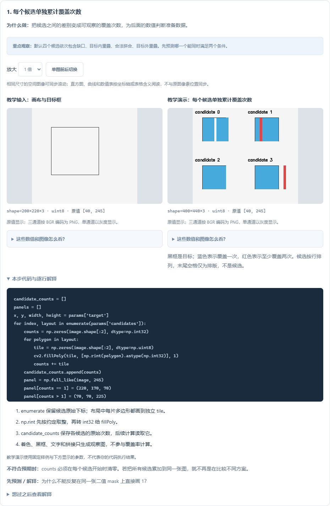
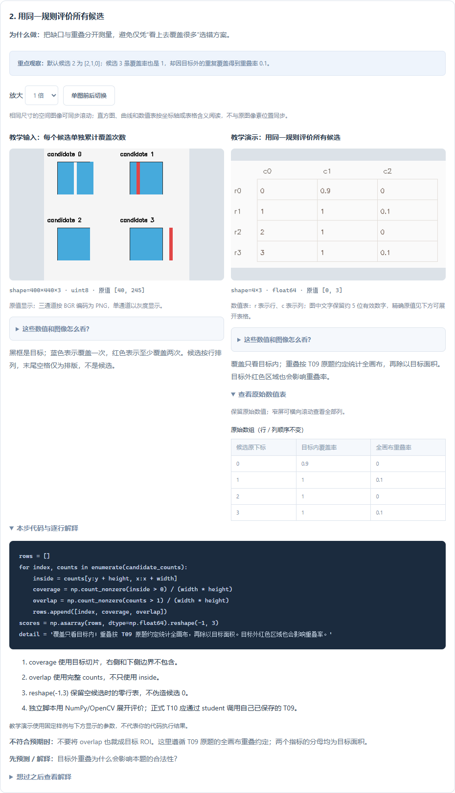

# 从评价布局到选择候选

0.18.0 新增 **T10 选择合法候选** 的五步图解、四组场景。平台累计 **42 / 44 道基础题有图解，124 个步骤、129 组参数配置**。

建议从 **T09 → T10** 学起。T09 回答“这个布局覆盖得怎样、有没有重叠”，T10 回答“多个方案里，哪一个符合要求”。这也是从单个图像处理函数接到工程决策的一小步。

入口：**基础练习 → T10 → 逐步图解**，或首页选择“拼图几何”目标路线再进入 T10。

## 四组输入，分别学什么

| 参数场景 | 改变什么 | 演示返回的原下标 | 合法数量 | 需要解释的问题 |
| --- | --- | --- | --- | --- |
| 0 原顺序 | 缺口、内部重叠、合法、外部重叠四种候选 | 2 | 1 | 为什么覆盖完整仍可能不合法？ |
| 1 重排 | 只重排同一组方案 | 0 | 1 | 为什么答案下标变化，而判断规则没变？ |
| 2 无解 | 移除合法方案 | -1 | 0 | 如何阻止后续把 -1 当成最后一个候选？ |
| 3 多个合法 | 同时提供竖向拼合和横向拼合 | 1 | 2 | 两个都合法时，是否一定要找“最佳”？ |

场景 3 的合法原下标为 `[1, 3]`，正式题允许返回其中任一个；演示固定选第一个以便重复观察。原题不要求最优解，也没有证明唯一解。如果你选择另一个合法下标，图解与固定演示的数组可能出现差异；这不代表该选择违反正式题规则，应回原题按约定验收。



输入图只画出画布与目标黑框，实际候选坐标在“本次实际输入参数”中。输出蓝色表示一次覆盖，红色表示重复覆盖；它们是辅助观察图，不是相机照片。目标轮廓、文字和排版不参与统计。

## 五个步骤怎么手敲

| 步骤 | 关键操作 | 保存的结果 | 自查 |
| --- | --- | --- | --- |
| 1 单独累计 | 每个候选清零；每片画独立 0/1 掩膜，再累加 | 候选观察图 `overview` | 各候选不能互相污染，`counts` 用 int32 |
| 2 统一评价 | 统计覆盖与重叠，分母都用目标面积 | 三列 `scores` | 覆盖只看目标内，重叠按全画布统计 |
| 3 同时满足 | `coverage >= .98` 与 `overlap <= .02` | 四列 `checks` | 数组逐元素用 `&`，两项缺一不可 |
| 4 返回原下标 | 找出满足条件的位置，空列表返回 -1 | 两列 `selection` | 原题返回整数 `selected`，不是整张表 |
| 5 正确消费结果 | 仅在 `selected >= 0` 时索引 | 选中布局图 `output` | 无解时不绘制候选，不读取列表末项 |

下载实验包或在 VS Code 打开分步代码后，一次完成一个步骤，再取消本步三行保存代码的注释。运行 `practice.py`，读取 / 导入 `results.zip`；用分步检查清单定位漏保存或差异。不要把直接运行参考脚本视为独立完成。

## 目标内外的计算约定

设目标矩形为 `(x, y, width, height)`，`counts` 为各片的 0/1 掩膜相加：

- 覆盖率 = 目标切片中 `counts > 0` 的像素数 / 目标面积。
- 重叠率 = **全画布** `counts > 1` 的像素数 / 目标面积。

本例目标为 `[40, 40, 100, 100]`，切片是 `[40:140, 40:140]`；右下端点不包含。绘制的矩形角点则用 `(139, 139)`，不要把多边形的包含边界和切片的排除边界混淆。

默认评分表：

| 原下标 | 覆盖率 | 重叠率 | 是否合法 |
| --- | --- | --- | --- |
| 0 | 0.9 | 0 | 否，有缺口 |
| 1 | 1 | 0.1 | 否，目标内重叠 |
| 2 | 1 | 0 | 是 |
| 3 | 1 | 0.1 | 否，目标外重叠 |



T09 的早期逐步示例在目标内观察重叠，给定样例在目标外没有重叠，因此得到相同数值。**复用正式 T09 函数时要遵循原题的全画布重叠约定**。T10 增加外部重叠反例，正是为了避免把观察样例的简化范围直接照搬到组合任务。

这两个阈值和栅格计数方法属于本课程，不是比赛标准。它们也没有额外限制“所有碎片必须在目标内”、真实物理拼缝或机械可执行性；工程中需要另外定义这些约束。重叠率以目标面积为分母，也不能在任意目标外布局中一概假定上限为 1。

## 原生函数到底用在哪里

- `enumerate(candidates)` 同时拿到原下标和布局，默认从 0 计数：[Python 官方说明](https://docs.python.org/3/library/functions.html#enumerate)。
- `cv2.fillPoly` 把每片多边形填到独立图像中；本课程先 `np.rint` 再转 int32，统一坐标取整规则：[OpenCV 绘图接口](https://docs.opencv.org/4.13.0/d6/d6e/group__imgproc__draw.html)。
- `np.flatnonzero(accepted)` 在一维布尔判断中取出 True 的原位置，而不是取出判断值：[NumPy 官方说明](https://numpy.org/doc/stable/reference/generated/numpy.flatnonzero.html)。

图解实验包只使用原生 Python、NumPy、OpenCV，不依赖平台内部模块。正式 T10 中的 `student('T09', image, child)` 是平台调用你已保存 T09 代码的适配接口，**不是 OpenCV 函数**；独立工程中应导入自己的评价模块并调用普通函数。

正式组合时先复制参数字典，再设置当前候选的 `layout`。这样不会把上一个候选或者被修改的父参数错误传给下一次评价。图解不运行你保存的 T09，因此图解一致后仍要先验收 T09，再验收 T10；修改前置实现后需重新检查组合题。

## 用十几行代码验证两个常见陷阱

新建普通 Python 文件，在现有 NumPy 环境运行下面的独立小实验：

```python
import numpy as np

scores = np.array([[0.90, 0.00], [1.00, 0.10], [1.00, 0.00]])
accepted = (scores[:, 0] >= 0.98) & (scores[:, 1] <= 0.02)
indices = np.flatnonzero(accepted).tolist()
selected = int(indices[0]) if indices else -1
assert selected == 2

none = np.array([False, False, False])
assert int(np.argmax(none)) == 0  # 这不是找到了合法解！
indices = np.flatnonzero(none).tolist()
selected = int(indices[0]) if indices else -1
assert selected == -1

candidates = ['有缺口', '重叠过多', '最后一个候选']
assert candidates[-1] == '最后一个候选'
if selected >= 0:
    print('可以继续处理', candidates[selected])
else:
    print('没有合法方案，请生成其他候选或检查输入')
```

再把 `scores` 改成两个合法行，确认你返回的是原始位置。最后用 `[0.98, 0.02]` 测试边界，思考为什么换成严格 `>` / `<` 会错误拒绝边界样例。

## 学完以后怎样验收

你应能解释：每个候选为什么要单独计数；为什么两个约束要同时满足；为什么重排后下标会变；为什么 -1 不能直接索引；多个合法结果为什么不代表最优或唯一。

返回原题后用自己的 T09、T10 完成多样例验收，再继续 T11 身份匹配或 A06 候选搜索。T10 只负责筛选已给出的方案，不会生成完整拼图搜索空间。42 道图解保留旧笔记与进度，剩余 A06、T14 仍可使用原有讲解、函数学习和验收。

已有插件执行 **Vision: 检查插件更新**；首次安装见 [Releases](https://github.com/CaoYujie-code/VisionLearningHub/releases)。官方资料核对日期为 2026-11-03；在线文档版本会变化，项目依赖以锁文件为准。

[本版验收记录](验收记录-0.18.0.md) · [手机约束表](images/candidate-mobile-0.18.0.png)
