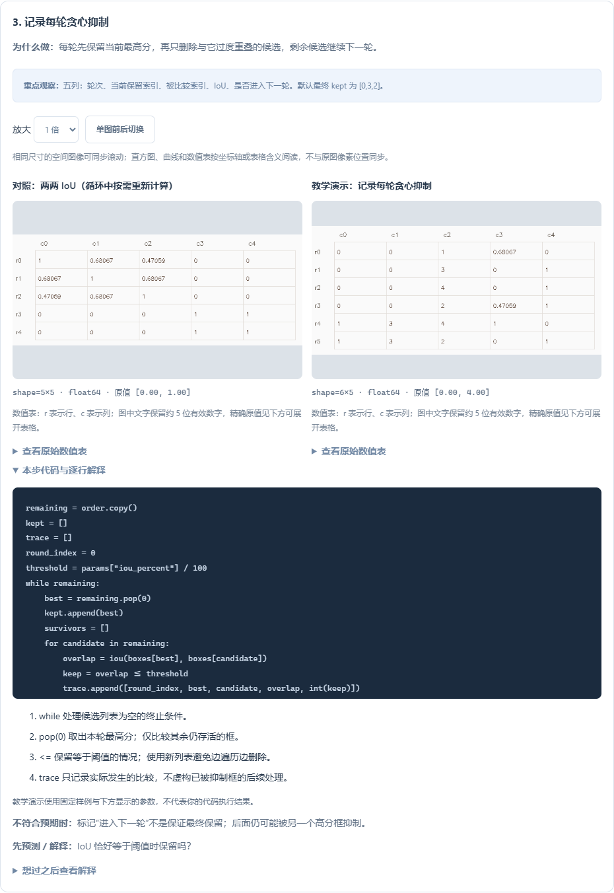
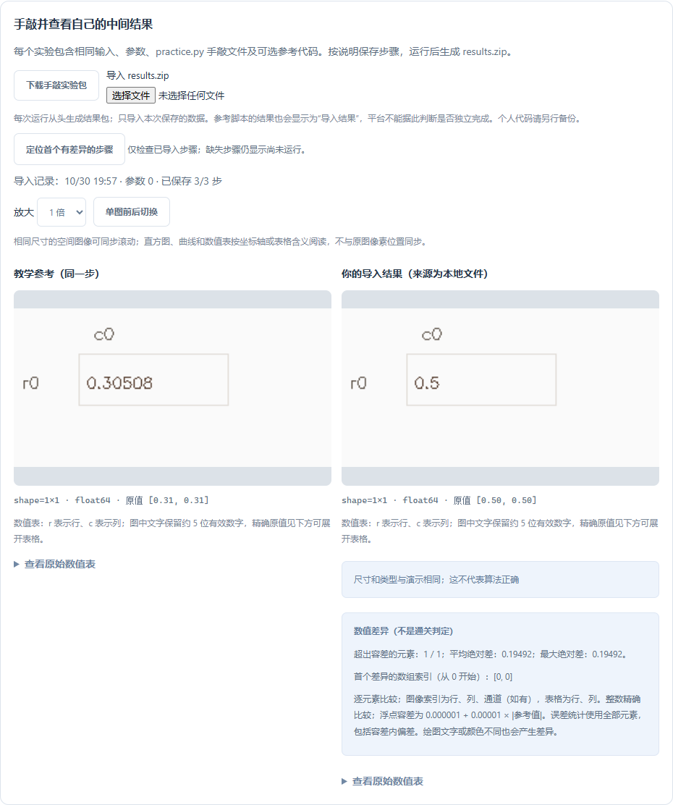

# 0.11.0：从数组到几何，知道每一步为什么这样做

本版新增 P01、P02、T07、T08、T09、T12、A04、A05，共 8 题、26 步。累计 **31 / 44 道基础题、84 步、95 组参数配置**。原有 23 题定义与进度修订标识保持不变。其余 13 题保留原有函数讲解、练习与验收。

## 从哪里进入

打开基础练习，勾选左侧“只看有逐步图解的题”，再选题并打开“逐步图解”。筛选状态会记忆；取消勾选可回到全部基础题。它只是筛选目录，不会重置代码或学习记录。

建议分三条线学习，不必一次读完：

| 路线 | 题目顺序 | 需要能解释的问题 |
| --- | --- | --- |
| 数组入门 | P01 → P02 → T02 → T03 | 索引与值有什么区别？切片顺序是什么？布尔掩膜如何统计？ |
| 拼图几何 | T06 → T07 → T08 → T09 → T12 | 中心怎么求？绕谁旋转？覆盖与重叠有何不同？帧间身份如何对应？ |
| 检测后处理 | A04 → A05 | 交集怎么算？为什么减一次交集？为什么低分框仍可能保留？ |

## 八题的观察实验

| 题目 | 分步结果 | 改参后应观察到 |
| --- | --- | --- |
| P01 面积筛选 | 索引/面积表 → 判断表 → 保留索引 | 阈值 80 保留 3、4、5；150 得到空表，不能补成 `[0]` |
| P02 区域统计 | ROI → 亮点掩膜 → 均值/计数/尺寸 | 提高阈值，白点减少或不变；原 ROI 均值不变 |
| T07 中心角点 | 原始轮廓 → 矩中心/面积 → 角点与中心叠加 | epsilon 增大，近似通常更简化；过大会丢角点，中心使用原轮廓 |
| T08 旋转平移 | 旋转矩阵 → 旋转点表 → 平移后轮廓 | 90 度把 `(x,y)` 变成 `(-y,x)`；图像 y 轴向下，正角屏幕上呈顺时针 |
| T09 拼图覆盖 | 覆盖次数热图 → 重叠掩膜 → 两个比例 | 向左移 30 像素：覆盖率 0.875，重叠率 0.125；重叠和缺口同时出现 |
| T12 多帧稳定 | 各帧点 → 对齐表 → 中位数/均值表 → 叠加图 | 单帧异常把均值拉偏，中位数较稳定；按 x 排序只适合本例身份不交叉的条件 |
| A04 IoU | 两框交集 → 面积表 → IoU | 第二框右移，交集缩小直到 0；连续框坐标面积不加 1 |
| A05 NMS | 分数排序 → 两两 IoU → 每轮抑制记录 → 保留框 | 阈值 20/50/80 分别保留 `[0,3]`、`[0,3,2]`、`[0,1,3,2]` |

每一步都有“为什么做”“重点观察”“代码与解释”“不符合预期时”“先预测/解释”。先尝试回答，再展开解释。数值表中的 r/c 是行/列索引，列的业务含义在“重点观察”中说明；可展开原始数值表或放大预览。

## 手敲、运行、定位差异

1. 在图解中选好参数，再切换“分步手敲”。
2. VS Code 点击“在 VS Code 打开分步代码”；网页版点击“下载手敲实验包”，解压后用 VS Code / PyCharm 打开 `practice.py`。
3. 每完成一步，取消该步保存数组的三行注释，运行文件得到 `results.zip`。
4. VS Code 点击“读取我的步骤结果”，或在网页导入 `results.zip`。只显示本次实际保存的步骤。
5. 如果有差异，点击“定位首个有差异的步骤”。检查原始数组索引、超出容差的元素数量、平均绝对差和最大绝对差。
6. 回到该步核对坐标顺序、类型、阈值等号和数据来源；修正后重新运行、重新导入。最后回原题做多样例验收。

示例：A04 默认 IoU 约为 0.305085，如果你保存 0.5，会显示一个差异元素，位置为 `[0, 0]`，绝对差约 0.194915。若误保存成两列，先提示尺寸不一致，不强行广播比较。

整数逐元素精确比较；浮点判断采用 `|实际−参考| <= 1e-6 + 1e-5 × |参考|`。绝对差统计包括容差以内的偏差，所以“差异元素为 0”时平均差也可能很小但非零。图像、矩阵、直方图按原始数组比较；图像文字、颜色不同也会产生差异。这个工具帮助排查，不证明算法在其他输入上正确，也不能判断是否独立完成。

“首个差异”只在已导入步骤中查找；没有导出的步骤仍显示“尚未运行”。未匹配的课程版本和参数不会混作当前对照。较早版本导入的结果可以继续看，重新运行并导入后才会产生新差异统计。

## 空结果与边界条件

P01 阈值 150 会得到 `(0, 1)` 的空表：没有满足条件的项，范围显示“空数组：无数值范围”。这与一行值为 0 完全不同。平台允许这种合法数值表导入，仍拒绝空图像、对象数组、非有限值和超限数组。

T07 跳过面积矩为零的轮廓，避免除零；A04 两个退化框并集为零时约定 IoU 为 0；A05 分数相同保持输入顺序，IoU 恰好等于阈值时保留。这些是本题明确约定，迁移到其他题目或库之前应再次核对。

## 学习记录与代码

本机记忆步骤、参数、模式、笔记和自评。导入数组、预览和差异统计随运行记录保存，可使用平台备份恢复。清除缓存保留运行记录；清除历史会移除导入结果；清除全部记录移除学习状态。个人 Python 源码不会因此被删除，仍需使用 Git 或单独备份。

本版不新增学习环境依赖。实验代码只调用 Python、NumPy 和 OpenCV；A05 的 `iou` 是你可以自己编写、复制运行的普通 Python 函数，没有平台专属图像处理接口。

## 官方资料

- [OpenCV：轮廓面积矩、周长与多边形近似](https://docs.opencv.org/4.x/dd/d49/tutorial_py_contour_features.html)：配合 T07 阅读。
- [NumPy：argsort](https://numpy.org/doc/stable/reference/generated/numpy.argsort.html)：配合 T12 与 A05 理解索引排序。
- [NumPy：median](https://numpy.org/doc/stable/reference/generated/numpy.median.html)：配合 T12 理解按指定轴求中位数。
- [NumPy：isclose](https://numpy.org/doc/stable/reference/generated/numpy.isclose.html)：理解结果差异提示中的浮点容差。

链接于 2026-10-30 核对。官方 stable 文档可能随库版本更新；本项目依赖以 `requirements.lock.txt` 为准。
