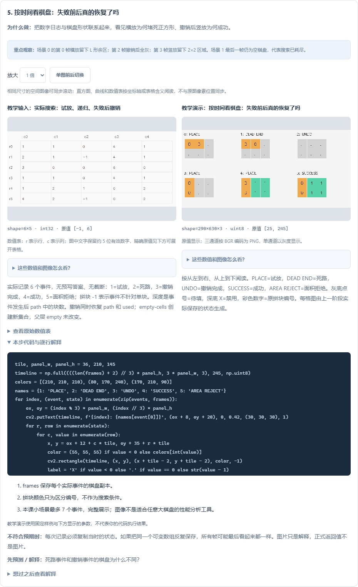

# 回溯拼图分步学习指南 · 0.20.0

A06 现在可以先看候选，再看代码真实执行时的试放、死路和撤销，最后回原题手敲 `solve` 并验收。基础题图解已覆盖 **44 / 44 题**，共 **137 个步骤、137 组参数配置**；这个数量不代表已经掌握全部视觉工程能力。

## 从哪里打开

在学习平台选择 **基础练习 → A06 DFS 与回溯拼图 → 逐步图解**。已有插件发布更新后执行 **Vision: 检查插件更新**。网页版与插件使用同一份课程；安装版本以实际发布为准。

先学 P01 的数组操作、T10 的候选筛选，再进入 A06。这里的输入已经是棋盘和拼块坐标，搜索本身用 Python 集合、列表和函数完成；NumPy/OpenCV 用于呈现表格、绘制棋盘，没有隐藏的平台求解函数。

## 六步分别回答什么

| 步骤 | 要理解的问题 | 观察什么 |
| --- | --- | --- |
| 1. 待覆盖集合 | 哪些格可以放？ | board 中 1 是目标，0 是禁用；remaining 只保留目标坐标 |
| 2. 旋转去重 | 转四次为什么不一定有四种朝向？ | 二连块只有 2 种，正方形只有 1 种；同形的两块仍保留不同编号 |
| 3. 锚点候选 | 怎样避免漏掉一种平移？ | 选最小空格，将每个朝向的每个格分别对齐它，检查整个候选是否在剩余集合内 |
| 4. DFS 与撤销 | 本次放得下，后面为什么仍会失败？ | 实际事件表中的深度、剩余格数、已用块数，以及配对的 add/remove、append/pop |
| 5. 棋盘时间线 | 撤销到底恢复了什么？ | 失败时的布局、撤销后的布局、换朝向后的布局 |
| 6. 正式交付 | None、[] 和完整布局怎样区分？ | 辅助棋盘表与正式 piece/cells 列表之间的关系 |

坐标使用 **(行,列)**。OpenCV 绘图使用 **(x,y)**，绘图时才把列映射到 x、行映射到 y，不要在搜索集合里混用。

## 先做四个预测

| 场景参数 | 输入安排 | 应得到什么 | 要学会的判断 |
| --- | --- | --- | --- |
| 0 | 2×3 棋盘，一块二连块、一块正方形 | 先失败再成功，返回两项布局 | 局部合法不代表整体可解 |
| 1 | T 形四格棋盘，两块二连块 | 试完后返回 None | 面积相同仍可能无解 |
| 2 | 六格棋盘，仅一块四格正方形 | 直接返回 None | 必要条件不满足时不用递归 |
| 3 | 全部禁用的棋盘，没有拼块 | 返回 [] | 空列表是一个合法解，和无解不同 |

先预测结果，再切换“图解实验参数”。四种场景使用同一段求解代码；事件不是提前写好的动画。本课最多 7 个事件，全部展示，不截断。

## 手工走一遍场景 0

第一块横放在左上角，剩下上方一格和下方三格，正方形无法放入。这个分支返回 `None`。父层弹出刚才的放置，并把该编号从 `used` 移除；下一次便可以重新使用这块，试着竖放在左边，留下右侧 2×2 正方形区域。

| 事件下标 | 事件 | 当前深度 | 剩余格 | 已用块 |
| --- | --- | --- | --- | --- |
| 0 | 试放二连块，横放 | 1 | 4 | 1 |
| 1 | 剩余区走不通 | 1 | 4 | 1 |
| 2 | 撤销本次试放 | 0 | 6 | 0 |
| 3 | 再试二连块，竖放 | 1 | 4 | 1 |
| 4 | 放入正方形 | 2 | 0 | 2 |
| 5 | 成功 | 2 | 0 | 2 |



图中点号是待填格，X 是禁用格，彩色数字是原始拼块编号。页面支持放大查看。事件表编码：1=试放、2=死路、3=撤销完成、4=成功、5=面积拒绝；拼块编号 -1 表示该事件不针对某一块。

`empty - cells` 创建一个新集合，所以父层的 `empty` 不会跟着减少；共享的 `path` 和 `used` 则必须由本层配对恢复。失败时只撤销本层的操作，不清空父层已经成立的布局。

## 先手敲这个最小实验

下面仅验证撤销的状态变化，不求解完整拼图。直接使用 Python 内置类型，可以在 VS Code 新建 `.py` 运行。

```python
empty = {(r, c) for r in range(2) for c in range(3)}
cells = {(0, 0), (0, 1)}
used, path = set(), []

assert cells <= empty
used.add(0)
path.append({'piece': 0, 'cells': sorted(cells)})
child_empty = empty - cells
assert len(child_empty) == 4
assert len(empty) == 6  # 父层集合没有改变

path.pop()
used.remove(0)
assert path == [] and used == set()

empty_answer = []
failed_answer = None
assert not empty_answer and not failed_answer  # 两者都是假值
assert empty_answer is not None                # 但 [] 是合法空解
assert failed_answer is None
print('本层可变状态恢复完成，父层集合保持原状')
```

列表可用 `append/pop` 表达后进先出的路径，集合支持差集与子集检查，参见 [Python 数据结构教程](https://docs.python.org/3/tutorial/datastructures.html#sets)。空列表和 `None` 都是假值，所以本题应以 `answer is not None` 判定找到解，参见 [Python 真值规则](https://docs.python.org/3/library/stdtypes.html#truth-value-testing)。资料核对日期：2026-11-03。

## 在 VS Code 中逐块实现

1. 先在图解页选择场景 0，打开分步实验目录。填写 `practice.py` 中当前步骤，按照文件中的保存提示生成步骤数组；不会要求你导入平台内部函数。
2. 先完成 `remaining` 和旋转表，检查二连块有 2 种朝向、正方形只有 1 种。空场景应保留零行表。
3. 写锚点候选，检查 `cells <= remaining`。不要只将拼块左上角对齐锚点；那会漏掉需要用其他局部格覆盖锚点的方案。
4. 写递归与事件记录，重点检查场景 0 的撤销事件：剩余格数恢复为 6，已用块数恢复为 0。记录快照要保存副本。
5. 运行后读取步骤结果；网页版可导入 `results.zip`。检查清单可定位首个待检查步骤。参考文件用于对照，手敲练习在 `practice.py` 完成。
6. 写下“第一次失败的原因”和“撤销恢复了哪两份状态”，刷新页面检查记录；再完成另外三个场景。
7. 点击 **独立挑战：回到原题**，实现正式 `solve(image, params)` 并进行多样例验收。

## 怎样判断自己真的理解了

- 能解释为什么固定一个空格不会漏掉完整解，以及为什么仍要枚举拼块的所有局部格。
- 能指出 `path.pop()` 与 `used.remove(index)` 必须配对，知道集合差集为什么不需要手动加回。
- 能预测等面积无解场景会穷尽候选，面积不符场景不会进入递归。
- 能解释旋转与镜像的区别；本题只允许旋转、平移。
- 能正确返回 `None`、`[]` 或包含 `piece/cells` 的完整列表，不把事件表或图片当成正式答案。

允许多个正确布局。自己的搜索顺序不同，中间数组也可能不同；图解提示差异后，应根据原题检查完整覆盖、无重叠、块形状和每块恰好使用一次。与演示数值相同也不会自动获得原题成绩。

复杂棋盘可能需要更强的剪枝或其他求解方法。本课只讲清微型离散问题，不包含相机分割、真实碎片离散化或机械执行；工程联调要分别验证这些模块。
