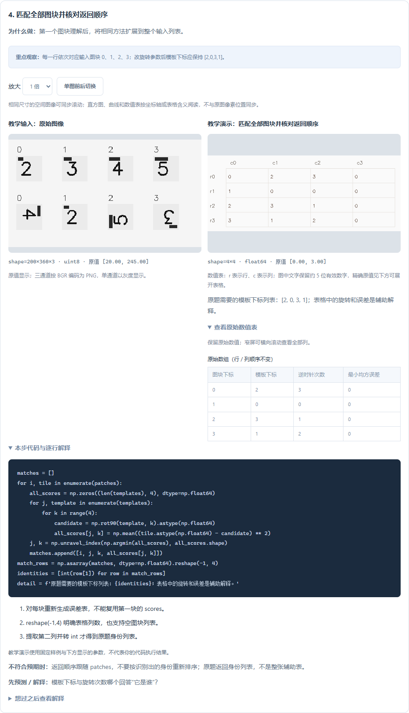
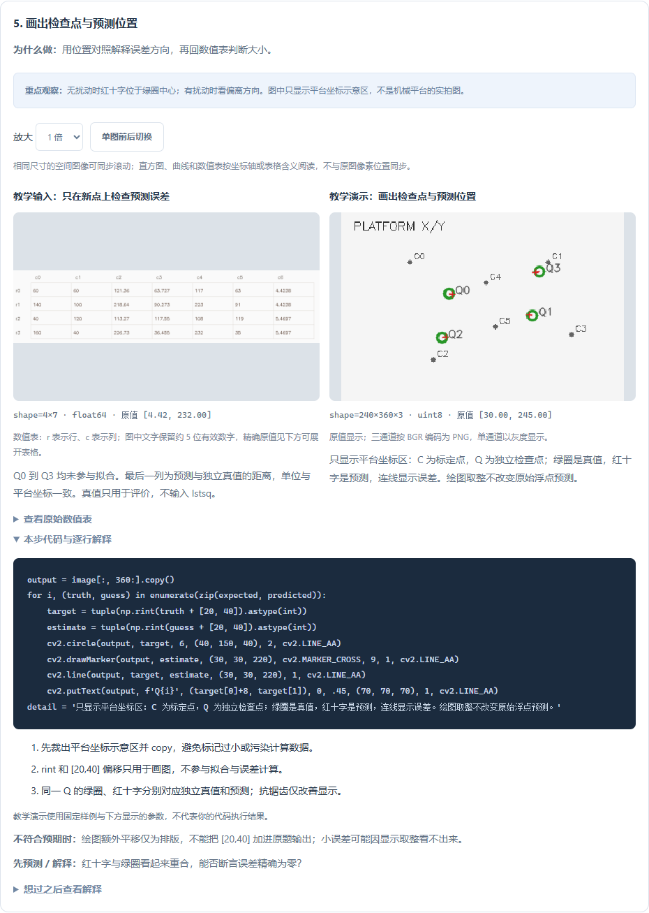
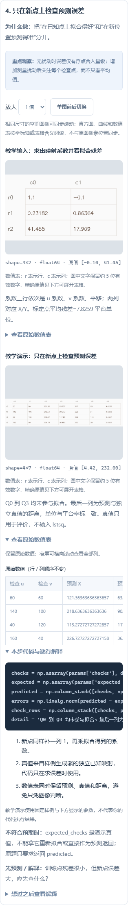

# 0.15.0：看清图案怎样匹配、坐标怎样标定

新增 **T11 图案与身份、T13 像素到平台** 两道逐步图解，共 9 步、6 组参数配置。累计 **39 / 44 道基础题、112 个步骤、119 组参数配置**。

每一步都有真实数组、处理结果、原生代码、解释、观察重点、错误排查和预测问题；可在 VS Code 打开分步文件，也可下载实验包到普通 Python 环境手敲，再导入实际保存的结果。

## T11：从“像不像”到误差表

输入上排为四个模板，下排为打乱身份并旋转后的图块。参数改变图块的额外逆时针旋转次数，身份保持不变。

| 步骤 | 看什么 | 手敲时先验证 |
| --- | --- | --- |
| 1. 观察四种朝向 | 候选模板 2 的四种直角旋转 | k 表示旋转次数，默认方向为逆时针 |
| 2. 计算完整误差表 | 行是模板下标，列是 k=0/1/2/3 | 先转 float，再相减、平方、求平均；数值越小越相似 |
| 3. 对齐并看差异 | 最佳候选与第 0 块的绝对差 | 全黑且原始差值全为零，表示本例完全一致 |
| 4. 匹配全部图块 | 输入下标、模板身份、旋转次数、误差 | 输出身份顺序跟随 patches，不能按模板身份重新排序 |

先预测：旋转参数从 0 改到 3，身份是否变化？本例身份列表应始终是 `[2,0,3,1]`；旋转次数随之变化。它们分别回答“是谁”和“怎样对齐”，不是同一个编号。

不要把零差异黑图误认为坏图；先看本步输出的含义。也不要把最小误差当作概率：重复模板或对称图案会出现并列最优，本例代码取第一个，并未解决歧义。当前方法假设等尺寸、仅直角旋转、无噪声，真实光照、遮挡、任意姿态需要另外处理。

## T13：先对应，再拟合，最后独立检查

输入 C0–C5 是已知对应点；视觉与平台两边同一个编号代表同一物理位置。参数把平台测量扰动幅度设为 0、2 或 8，点的位置和扰动方向固定。

| 步骤 | 中间结果 | 为什么要观察 |
| --- | --- | --- |
| 1. 排好对应点 | 视觉 u/v 与平台 X/Y 四列表 | 先确认同一行是同一个点，不能两边各自排序后误配 |
| 2. 构造设计矩阵 | 每行 [u,v,1] | 常数列负责平移；检查秩，拒绝共线点 |
| 3. 拟合映射 | 3×2 系数与标定点平均残差 | 三行是 u 系数、v 系数、平移；两列分别计算 X、Y |
| 4. 检查新位置 | 检查点、预测、独立真值与距离误差 | Q0–Q3 不参加拟合，避免只在训练点上自证准确 |
| 5. 画位置对照 | 平台区绿圈、红十字与误差连线 | 绿圈为真值，红十字为预测；精确误差仍看浮点表 |

无扰动时，系数应接近三行 `[1.2,-0.1]`、`[0.25,0.9]`、`[30,15]`，检查误差只有浮点舍入量级。改为 2 或 8 后观察系数和检查误差，而不是只看图上是否接近。

教学真值来自已知合成映射，**仅用于计算误差，不传入最小二乘拟合**。原题最终返回预测坐标，不返回真值或辅助表。绘图裁剪、取整和排版偏移也不应加入原题输出。

共线点会在矩阵检查处抛出 ValueError；若在自己的实验中构造这种情况，应该修正标定点分布，而不是删除检查继续输出。近共线、模型不适用、真实设备测量误差还需进一步诊断，本例不替代实机标定。

## 手敲与结果导入

1. 在图解中选定参数，先预测下一步的结果。
2. 点击“在 VS Code 打开分步代码”，或下载手敲实验包。
3. 在 `practice.py` 中实现一小步，取消该步保存数组的三行注释，然后运行。
4. 读取或导入 `results.zip`，只会展示真正保存的步骤；未执行步骤不会伪造结果。
5. 若有数值差异，可跳到首个不同步骤。理解后回到原题实现 `solve`，再做正式验收。

实验包带有输入图、参数和可选 `reference.py`，全部使用原生 NumPy/OpenCV。参考结果导入不证明独立完成，也不授予通关。T11 的表格辅助观察身份与朝向，T13 的真值辅助评价；都不改变原题返回约定。

手机可横向滚动原始数值表查看全部列；图像中标记很接近时，查看原始误差比凭缩略图判断更可靠。观察笔记、参数、步骤与导入诊断可恢复。

## 覆盖范围与资料

旧 37 道图解定义保持一致；本版只增加两题，既有修订标识与学习记录兼容。剩余 **T10、T14、A06、Y01、L01** 五题仍通过函数讲解、提示及原题练习学习，尚未制作逐步图解。

- [NumPy rot90](https://numpy.org/doc/stable/reference/generated/numpy.rot90.html)：旋转次数、方向与返回视图，2026-11-02 核对。
- [NumPy lstsq](https://numpy.org/doc/stable/reference/generated/numpy.linalg.lstsq.html)：最小二乘输入和返回值，2026-11-02 核对。

线上文档可能高于项目锁定版本，运行环境仍按项目锁文件安装。功能验收检查数值正确性和保存行为，不声称已证明初学者学习效率提升。

[目标路线](目标路线与进阶起步指南-0.14.0.md) · [本版验收](验收记录-0.15.0.md)
