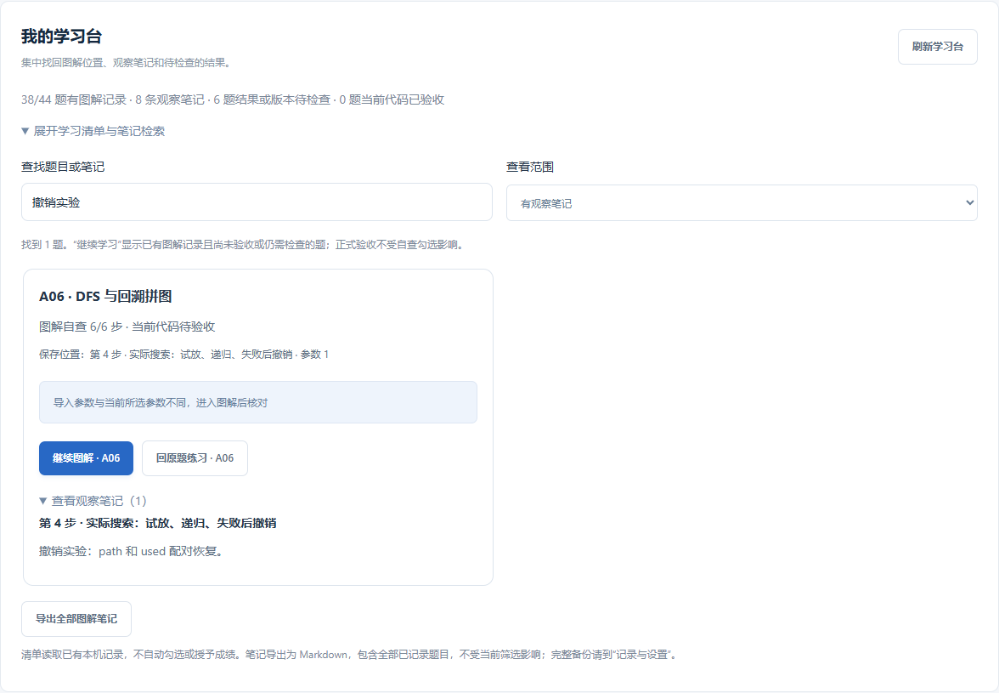

# 学习台与笔记复习指南 · 0.21.0

在 **学习总览 → 我的学习台**，展开“学习清单与笔记检索”，可以集中查看基础题图解的保存位置、观察笔记、导入结果和当前代码验收状态。支持网页版和可选安装的 VS Code 插件。

## 你可以怎样用

| 想做什么 | 操作 |
| --- | --- |
| 接着没学完的题继续 | 选择“继续学习”，点击对应题的“继续图解” |
| 找到前几天记录的问题 | 搜索题号、标题或观察笔记中的词，例如“撤销”或“阈值” |
| 看哪些实验还需要检查 | 选择“结果待检查”，看缺失、差异、无法比较、参数或版本提示 |
| 从图解转到独立实现 | 点击“回原题练习”，直接进入该题的任务标签 |
| 复习自己写过的解释 | 选择“有观察笔记”，展开卡片中的观察笔记 |
| 寻找尚未验收的基础题 | 选择“待正式验收”；也可以用“全部基础题”自由浏览 |
| 把观察笔记带走 | 点击“导出全部图解笔记”，保存为 Markdown |

“继续图解”恢复该题最后保存的步骤、参数、学习模式和观察记录。“回原题练习”打开任务标签，不受上次停留标签影响。离开练习时仍遵守已有的保存保护，保存失败不会悄悄丢掉草稿。

首次使用没有图解记录时，“继续学习”可以是空列表；切换“全部基础题”后开始一题即可。清单默认折叠，避免首页被 44 张卡片占满。筛选和搜索词会记住；回到首页时重新读取已有记录，也可以点击“刷新学习台”。

## 四类数字分别表示什么

- **有图解记录的题数**：已经保存过图解位置、自查或笔记，或者有导入结果。打开看过但没有保存操作，不一定产生记录。
- **观察笔记数**：当前课程版本下，非空的逐步观察笔记数量；不包含原题“笔记”标签和章节笔记。
- **结果或版本待检查**：导入缺步骤、有数值差异、不能比较、参数不同、课程版本改变或记录无法读取，需要进入题目核对。
- **当前代码已验收**：沿用正式多样例验收结果。仅阅读、自查、导入或与参考数值一致，都不计入正式成绩。

例如，A06 显示“图解自查 6/6 步 · 当前代码待验收”，表示你已自行标记六步理解，但还需要回原题提交并验收自己的 `solve`。这两项可以同时成立。

## 怎样读导入状态

| 提示 | 意义 | 下一步 |
| --- | --- | --- |
| 尚未导入 | 没有自己的结果包 | 在分步代码中保存数组并导入 |
| 已保存 / 缺失 | 统计实际保存在结果包内的步骤 | 核对漏掉步骤的保存代码 |
| 有差异 | 同尺寸、同类型数组中发现超出容差的元素 | 进入图解定位差异，结合算法判断原因 |
| 无法比较 | 缺少可用数值对照，或尺寸/类型等不符合比较条件 | 先核对数组约定 |
| 参数不同 | 导入参数和当前所选参数不一致 | 回图解切换参数或重新生成结果 |
| 旧课程版本 | 旧结果不代表当前版本 | 重新下载实验包并运行 |
| 本次数值一致 | 当前保存结果与对应演示数值一致 | 回原题用多样例验收独立实现 |

多解任务可能得到不同但正确的布局。数值差异是排查入口，不能单独代替正式正确性判断。

课程更新导致定义变化时，旧自查不计入当前进度，清单显示版本提示。导入文件损坏时单题显示“无法读取”，不会把整个学习台清空或冒充未开始。

## 一次 20 分钟的用法

1. 用 2 分钟在“继续学习”选一题，读自己上一条观察笔记。
2. 用 5 分钟回到保存的图解步骤，预测变化，比较实际中间结果。
3. 用 8 分钟在 VS Code 的分步文件手敲并运行，读取自己的步骤结果。
4. 用 3 分钟记录“哪里与预测不同、原因是什么”，然后回原题实现对应逻辑。
5. 用 2 分钟回到学习台查看状态；需要离线复习时导出笔记。

这是可自行调整的学习建议，不是平台计时器，也不会自动记录学习时长。

## 导出、备份与清除

导出文件名为 `vision-study-notes.md`，包含所有有图解记录或正式验收记录的基础题，以及当前版本的逐步观察笔记。**当前筛选不会限制导出范围**。代码块样式的笔记按原文保留，不会当作脚本执行。

网页版通过浏览器下载；VS Code 使用保存对话框选择 Markdown 文件位置。导出图解笔记不自动保存其他尚未保存的练习源文件，也不改变正式成绩。

这是一份便于阅读的笔记快照，不能作为完整恢复包。要迁移学习进度、代码和其他笔记，请继续使用 **记录与设置 → 备份 / 恢复**。清除全部记录后学习台会重新显示空进度；恢复已有完整备份后按恢复数据重新生成清单。清除运行历史会移除导入结果，图解自查与笔记按现有清除范围保留。

读取失败时页面会提示错误；如果已有数据，会明确标记为上次读取的记录，点击“重试读取学习台”更新。页面不会将读取失败显示为零进度。

## 范围

本轮集中管理 **44 道基础题的图解记录**，没有增加新的教学题目。9 个工程项目、函数理解自测、章节与资料收藏仍通过各自入口使用。没有引入云端同步、自动复习提醒或学习时长统计。

[手机界面](images/study-desk-mobile-0.21.0.png) · [验收记录](验收记录-0.21.0.md)
