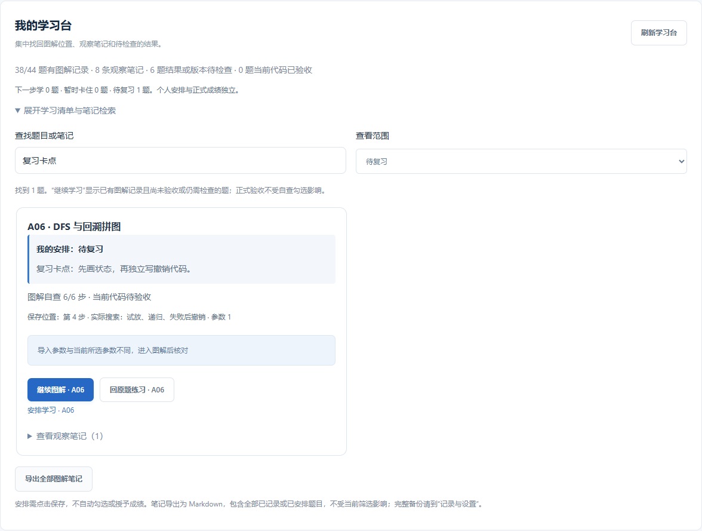

# 学习安排与卡点复习指南 · 0.22.0

在 **学习总览 → 我的学习台**，展开清单，在题目卡片点击 **安排学习**。你可以选择“下一步学”“暂时卡住”或“待复习”，并写下最多 1000 字的下一步或卡点。点击“保存安排”后保存到本机。

## 三种安排怎样用

| 安排 | 建议用途 | 可以写的备注 |
| --- | --- | --- |
| 下一步学 | 已经选定接下来要做的题 | 先观察阈值改变后白色区域如何变化，再手敲 threshold |
| 暂时卡住 | 知道题目目标，但卡在某个具体位置 | 会写 path.pop，但不明白为什么还要 used.remove |
| 待复习 | 做过或看懂了，想重新独立完成 | 隔一段时间遮住参考，再写一次旋转去重和撤销 |

每道题同时保留一种安排，可以随时切换。安排是你的个人判断；即使正式代码已经验收，也可以一直保留“待复习”。系统不会因一次成功自动删除它，也不会因为添加安排而标记题目通过。

## 建议的一次使用过程

1. 在“全部基础题”找到准备学习的题，标记“下一步学”，写一个具体的小目标。
2. 点击“开始图解 / 继续图解”，观察中间结果并手敲。
3. 如果卡住，回学习台改为“暂时卡住”。写清楚“在哪一步、实际发生什么、自己预期什么”。
4. 再次学习时筛选“暂时卡住”，搜索备注中的关键词，直接返回原题或图解。
5. 能独立解释或实现后，改为“待复习”；确定不再需要这条安排时，清除本题安排。

例如，“不会 DFS”不容易指导下一步；“递归返回 None 后，父层剩余集合为什么不用加回格子”更容易对应到 A06 的具体解释和实验。

## 搜索、筛选和保存

学习台新增三种筛选范围，与原有的继续学习、结果待检查、有观察笔记、待正式验收和全部基础题共同使用。搜索会同时匹配题号、标题、观察笔记和学习安排备注。

“继续学习”仍表示已有图解记录且未验收或有结果待检查的题；刚安排但尚未开始的题，在“下一步学”等对应范围查看。安排不自动改变图解位置、已自查步骤或导入状态。

保存失败时，编辑窗口会显示错误并保留输入，可以直接重试。点击关闭、按 Escape 或在页面内尝试跳转时，尚未保存的修改会受到保护。**取消修改**只放弃本次窗口中的编辑，保留之前已经保存的安排。

这不是自动保存：关闭整个应用或电脑之前，请先点击保存。窗口里的编辑草稿不会当作已保存记录写入备份或导出。

## 清除和导出

编辑已有安排时可点击 **清除本题安排**。它只清除本题的安排状态和该条备注，其他题安排、原题代码、图解笔记及成绩继续保留。

**导出全部图解笔记**会同时导出个人安排和卡点备注。尚未开始图解、但已经安排的题也包含在导出中；导出范围不受当前搜索和筛选限制。Markdown 可直接在 VS Code 中打开阅读。

完整备份包含这些安排，恢复备份后重新显示。清除缓存或运行历史会保留个人安排；清除全部学习记录会同时清除安排。旧版没有个人安排的备份仍然可以恢复，恢复后安排为空。

## 范围与边界

- 本轮适用于现有 **44 道基础题**，每题一条安排和一条备注。
- 不包含日期调度、到期提醒、自动间隔复习或云同步。
- 不会自动判断你已经理解了某个函数，也不会自动生成或修改答案。
- 工程项目分块、函数自测和正式多样例验收继续通过各自入口使用。

[手机编辑窗口](images/study-plan-mobile-0.22.0.png) · [验收记录](验收记录-0.22.0.md)
