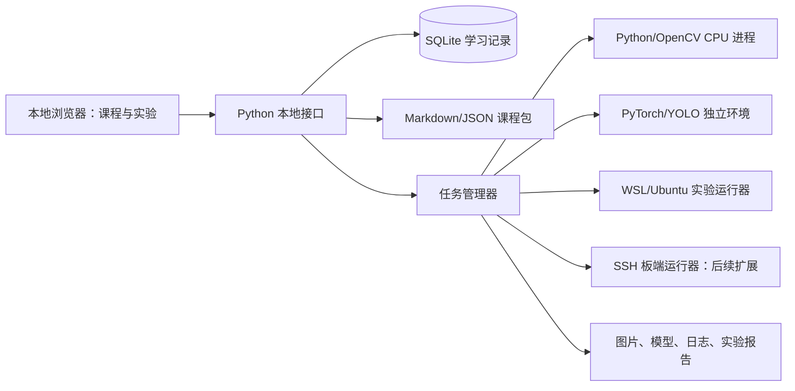

# 视觉学习与部署实验平台建设方案

日期：2026-10-25。状态：早期产品与工程设计存档。

当前 0.2.0 已完成本地课程、代码练习、图像实验和记录管理；以下设计仍包含后续功能。实际交付范围请以 [README](../README.md) 与 [使用指南](第一次使用与学习指南.md) 为准。

## 1. 建设目标

建立“理解问题 → 选择方法 → 手敲实现 → 对照实验 → 验证结果 → 总结适用条件”的学习流程。

学习者完成一节课后，应能回答：输入是什么、输出是什么、为什么选这个方法、参数改变会发生什么、它在哪些场景失效、换一种方法会怎样。

课程覆盖三条互相连接的线：

1. **图像与视觉算法**：OpenCV、颜色与几何、滤波与边缘、区域与轮廓、匹配、评价、搜索和时间稳定。
2. **数据驱动视觉**：PyTorch 基础、数据集、YOLO 推理与训练、评价、误检漏检分析和模型导出。
3. **系统与部署**：Linux 基础、C/C++ 与 CMake、摄像头、应用运行、嵌入式系统组成、板端推理与性能测量。

Linux 命令与环境管理可在早期并行学习；交叉编译、设备树与系统裁剪安排在会运行应用之后。

## 2. 面向初学者的产品结构

| 页面 | 解决的问题 | 主要内容 |
|---|---|---|
| 我的路线 | 下一步学什么 | 前置知识、建议顺序、当前代码的验收状态、设备条件 |
| 知识课程 | 这个方法为什么有用 | 图解、短代码、参数含义、适用与失败场景、资料链接 |
| 图像实验室 | 参数如何改变结果 | 原图、中间步骤、结果图、参数对比、局部放大与像素观察 |
| 练习与验收 | 能否独立实现 | TODO、逐步提示、代码运行、独立样例、反馈与错误定位 |
| YOLO 实验室 | 从数据到模型 | 标签检查、推理、训练任务、验证、错误样本与导出 |
| Linux 实验室 | 算法如何在系统中运行 | 文件与进程、真实终端任务、构建、摄像头、服务日志 |
| 项目实践 | 多个模块如何衔接 | 综合目标、数据流、阶段验收和实验报告 |
| 资料与复习 | 如何查阅与巩固 | 官方资料、收藏、版本标记、错题、个人笔记 |

每节课统一包含：目标、前置知识、输入输出、核心原理、适用条件、失效条件、操作步骤、练习、验收、延伸资料。

首版练习采用模板式代码编辑与普通脚本运行；后续再增加 Notebook 导出和完整终端交互。

## 3. 如何学会“适用情况”

教学不能只展示成功图片。每种方法至少准备：正常样例、可解释的边界样例、明显失败样例，以及可替代方法。

| 任务条件 | 可以先尝试 | 需要观察的限制 |
|---|---|---|
| 背景与目标颜色稳定 | HSV 分割＋形态学＋轮廓 | 阴影、反光、目标与背景同色 |
| 想定位亮度突变或轮廓线 | 梯度／Canny | 边缘线不等于完整前景区域；纹理会产生额外边缘 |
| 目标尺寸方向变化小 | 模板匹配 | 缩放、旋转、遮挡和光照差异 |
| 平面工件需要测量 | 标定、透视／几何处理 | 像素与物理尺寸转换依赖标定与成像条件 |
| 类别外观复杂、背景变化大 | 训练目标检测模型 | 数据覆盖、标注质量、分布变化和推理成本 |
| 目标检测后还需精确角点或尺寸 | 检测定位＋局部经典视觉 | 检测框本身不提供精密几何测量 |
| 要在板端实时运行 | 先测完整链路再优化 | 模型耗时之外还有采集、预处理、传输、后处理和显示 |

“算法选型题”要求学习者选择方案并解释证据。开放题采用评分要点或人工自评，不能用关键词命中伪装成完整理解。

## 4. 技术架构建议

建议采用 **本地 Web 界面 + Python 后端 + SQLite + 独立实验进程**。首版在本机启动，通过浏览器使用，后续增加桌面启动器。

选择依据：长篇课程、搜索、图片对照、曲线、标签预览和实验报告适合网页组织；Python 负责图像与模型执行；板端运行器通过统一任务协议接入。

| 选择 | 优点 | 代价与适合阶段 |
|---|---|---|
| PySide6 桌面 | 可复用旧平台界面与代码执行经验，直接操作本机图像 | 内容展示和复杂实验面板需要较多定制；适合以旧平台为基础的小步升级 |
| 本地 Web（推荐） | 内容、交互实验、跨 Windows/Linux 使用和后续扩展方便 | 初期需要前后端两部分；适合这次独立的通用学习平台 |
| 纯文档网站 | 课程资料易发布 | 无法独立完成本地 Python、模型训练和板端实验验收 |

建议组件：React + TypeScript 构建界面，FastAPI 提供本地接口，SQLite 保存个人学习记录，Markdown/JSON 定义课程与练习。实现时锁定经过验证的版本，不直接依赖各项目的 latest 环境。



UI 从已构建的静态文件启动，学习者日常使用不需要启动前端开发服务器。首版保持单用户本地模式，不引入账号体系、云数据库或分布式任务队列。

## 5. 执行环境要分开

| 实验类型 | 运行位置 | 没有对应设备时 |
|---|---|---|
| Python/NumPy/OpenCV | 本机 CPU 环境 | 可以正常学习和验收 |
| YOLO 标签、坐标、指标练习 | 本机 CPU 环境 | 可以使用已知数据完成，不需要训练模型 |
| 预训练模型推理 | 独立深度学习环境，可先用 CPU | 根据实际环境提示安装与下载；显示模型是否就绪 |
| 模型训练 | 独立 CPU/GPU 环境 | 可阅读流程、分析示例日志；训练状态明确显示未执行 |
| Linux 命令与应用构建 | WSL2、Linux 虚拟机或原生 Ubuntu | 可先做日志分析题；真实操作题保持待实验状态 |
| 摄像头与嵌入式部署 | 实际摄像头与指定开发板 | 显示硬件前置条件，保留阅读入口 |

CPU 能开展基础学习、小模型推理及小规模实验；训练速度与可用内存需实际测量。平台不能承诺所有硬件达到同一个 FPS。

WSL 可用于 Linux 用户空间学习，不作为已通过真实 ARM 板端、摄像头驱动或硬件加速的证据。Buildroot/Yocto、设备树与板端 SDK 需要单独的目标环境。

每个运行器报告环境、退出码、耗时、产物路径和检查结果；实现停止、超时、失败与中断状态。教学中的独立进程用于控制运行生命周期，并不等于对不可信代码提供安全沙箱。

## 6. YOLO 课程如何落地

按“数据 → 推理 → 训练 → 验证 → 错误分析 → 导出 → 部署”组织。

- 数据检查：类别编号、归一化框坐标、空标签、缺失图片、重复样本、训练与验证划分。
- 推理练习：读取输出，画框，逆转缩放与 padding，把坐标映射回原图。
- 训练实验：记录数据集版本、权重、配置、随机种子、依赖版本和训练日志。
- 验证：理解 precision、recall、IoU 与 mAP，观察误检、漏检、小目标和不同场景分组表现。
- 导出：保存输入颜色、布局、归一化、尺寸、输出格式及模型版本，检查导出前后误差。
- 部署：先完成 PC 上的可复现推理，再针对实际设备接入 ONNX Runtime、TensorRT 或 RKNN 等适配器。

模型家族、版本和导出方式由课程环境档案固定。NMS 作为独立基础算法教学；具体模型是否需要它、输出如何解释，以该模型的实际接口为准。

相邻视频帧或同一采集批次应按场景分组划分数据，避免训练集与验证集看起来不同、实际几乎重复。小数据集可用于验证训练流程；不能把一次跑完训练当作识别能力已可靠。

## 7. Linux 与嵌入式课程如何落地

先学应用开发，再进入系统构建：

1. 目录、文件、权限、管道、进程、环境变量、包与 Python 虚拟环境。
2. SSH/SCP、日志、进程退出、端口和依赖定位。
3. C/C++ 最小程序、指针与数组、CMake、动态库、架构与 ABI。
4. `/dev/video*`、V4L2、像素格式、帧率、摄像头读帧；GStreamer 放在需要媒体管线时学习。
5. 开发板上的 Python/C++ 推理程序、输入输出一致性、服务启动与崩溃恢复。
6. 理解 Bootloader、内核、设备树、根文件系统，再做 Buildroot；Yocto 作为后续工程化扩展。
7. 根据实际板卡选择一个加速分支。Jetson 与 Rockchip 的 SDK、模型转换和支持范围分别管理。

题目验收检查命令实际效果、生成的文件、构建产物、日志或设备输出。Windows 上的模拟命令界面只能用于演示，不能计作真实 Linux 操作通过。

## 8. 题目与验收体系

四种练习并存：概念与选型题、短函数手敲题、可运行实验题、综合项目题。

- 确定性图像题：检查 shape/dtype/坐标/几何或图像误差，允许契约范围内的等价实现。
- 算法题：给正常、空输入、临界值和无解样例，检查格式、数值、约束与终止行为。
- 模型题：检查数据与流程、独立验证报告及误检漏检分析，不要求训练曲线逐点相等。
- Linux 题：真实执行时检查文件、权限、构建、日志和程序行为；缺少环境时显示等待环境。
- 硬件题：记录设备型号、输入、延迟、输出与现场证据；人工确认与自动检查分别显示。

学习状态建议包括：未开始、阅读中、练习中、代码已验收、环境未就绪、修改后待复验。阅读、自查和自动验收各自存储。

验收绑定题目版本、当前代码及依赖、数据集/模型版本和环境档案；修改相关输入后提示复验。

## 9. 资料库与个人数据

资料卡包含：主题、难度、语言、官方来源、前置知识、对应课程、建议阅读任务、版本提示、链接核对日期。

每节课优先给 1～3 个明确的阅读入口，而不是让初学者面对整站文档。平台保存自己编写的教学解释、代码与实验素材，外部文章主要通过链接查阅。

SQLite 保存用户、进度、草稿、笔记、收藏、尝试记录、环境档案和任务元数据。图片、视频、模型权重和大日志单独保存，数据库只存引用及摘要。

备份包含数据库、草稿与实验清单；是否包含大模型、数据集由用户选择。恢复前完整校验、保留原记录，并校正迁移后的路径。旧平台内容可按明确的课程 ID 导入，避免把旧的通过标记直接套到新的验收规则。

## 10. 开发里程碑

| 里程碑 | 交付 | 验收重点 |
|---|---|---|
| M1 学习与实验基础 | 新平台界面、路线、资料库、笔记；Python/OpenCV 练习和图像实验室 | 能手敲、运行、逐组观察、保存与恢复；首批 10～15 道真实可运行题 |
| M2 YOLO 与 Linux 用户空间 | 数据集检查、预训练推理、训练任务、验证导出；真实 Linux 基础题 | 三个主方向均有真实实践；累计约 30 道练习为建设目标 |
| M3 嵌入式与综合项目 | 一个实际板卡分支、摄像头、板端推理与性能报告 | PC 与设备结果对照，记录采集到输出的完整链路 |
| M4 深入扩展 | 分割、跟踪、特征匹配、量化、系统裁剪与更多板卡 | 按学习需求扩展课程包和运行器 |

先把 M1 做成可独立使用的版本，再扩展 M2。所有课程卡明确标注“可阅读”“可运行”“需要环境”“规划中”，不把未实现页面算作已交付功能。

## 11. 建议工程结构

```text
VisionLearningHub/
  frontend/              # 路线、课程、编辑器、实验可视化
  backend/               # 本地接口、任务调度、数据访问
  runners/               # CPU、YOLO、Linux、板端适配器
  content/
    courses/             # Markdown 课程与章节元数据
    exercises/           # 题目契约、素材定义、验收规则
    resource_catalog.json
  datasets/              # 小型教学素材与数据清单
  model_manifests/       # 权重与输入输出约定，不强制放大文件
  docs/
  tests/                 # 验收逻辑、数据恢复与任务生命周期检查
```

以上是后续实现目录设计；本次实际只创建方案文档、资源目录和题目结构样例。

首轮实施前再确认实际电脑是否有可用 GPU、是否已有开发板及型号。课程主体可按普通 Windows 电脑开始设计，不要求先购买设备。
