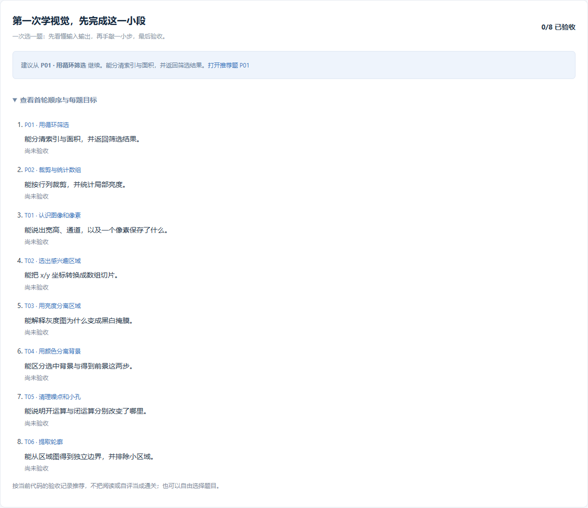
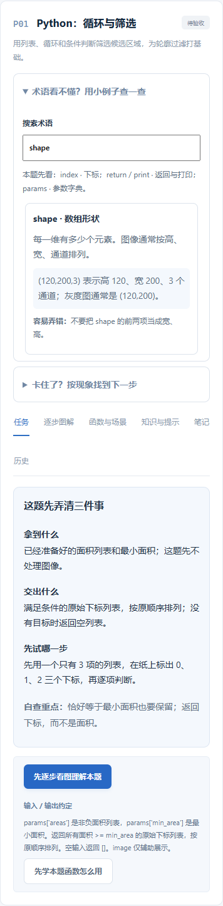

# 0.13.0：知道先学什么、先写什么、卡住后看哪里

这一版围绕已有题目降低起步难度，保持 **44 道基础题、37 道逐步图解、103 个图解步骤**。增加首页首轮路线、8 道起步卡、18 个术语解释和 4 类排查指引，并理清分步实验与原题验收入口。

## 检查发现了什么

| 发现的障碍 | 本版改动 | 希望帮助你做到 |
| --- | --- | --- |
| 内容很多，但首轮目标不够明确 | 首页给出 P01、P02、T01–T06 八题，并按当前代码验收情况推荐下一题 | 每次选一题，知道这一题需要学会什么 |
| 任务约定一次出现很多概念 | 八题增加“拿到什么 / 交出什么 / 先试哪一步”起步卡 | 先把输入、返回值和第一个动作说清楚 |
| shape、ROI 等词分散在各处 | 基础练习增加可搜索的 18 个术语，含解释、小例子和易错点 | 遇到陌生词时就地查，不必离开当前题 |
| 分步代码与原题代码的运行入口同时出现 | 图解标签专注 practice.py 与 results.zip，独立挑战返回原题 solve 和验收 | 确认当前写的是哪个文件、看的是哪一种结果 |
| 快速切标签后刷新可能赶在草稿自动保存前 | 切标签先等待原题草稿及学习记录保存，失败时留在当前标签 | 减少切换学习方式时丢失刚写内容的风险 |
| T01 旧提示仍使用平台辅助读图函数 | 改为 np.fromfile 与 cv2.imdecode 原生调用 | 把学到的读图步骤复制到普通 Python 工程中 |

这些改进来自对现有界面、代码和操作流程的检查，尚未做真实初学者的对照学习实验，不能据此承诺学习速度提升多少。

## 第一轮怎么学

进入“学习总览”，找到“第一次学视觉，先完成这一小段”。推荐依据是**当前代码**有没有通过验收；点开或看完一题不会被当作完成。已验收代码修改后若失效，推荐也会重新考虑该题。全部八题通过后，仍可自由回看。

| 题目 | 这一题能解释什么就够了 |
| --- | --- |
| P01 | 下标与数值有何不同？筛选后为什么要 return？ |
| P02 | 图像先写行还是列？ROI 里怎样统计亮点？ |
| T01 | 宽、高、通道怎样从 shape 读取？一个彩色像素有几个数？ |
| T02 | x/y/宽/高怎样变成数组切片？ |
| T03 | 提高阈值，白色区域为什么通常减少？ |
| T04 | 选出的绿色背景怎样变成需要的前景？ |
| T05 | 开运算去掉什么，闭运算修补什么？ |
| T06 | 轮廓坐标列表和画了轮廓的图片有什么区别？ |

打开题目后先读起步卡。不要立即照抄完整解答，可以先用三个列表元素、一个像素或一小块 ROI 验证自己的理解。起步卡目前覆盖上述八题；其他题仍使用原有输入输出约定、函数讲解和图解。

## 一道题的三个阶段

1. **看懂**：进入逐步图解，先预测，再观察教学结果、原始数值和代码解释。
2. **手敲验证**：使用分步 `practice.py`，完成一步就保存该步数组，运行后读取或导入 `results.zip`；检查实际输出和差异。
3. **独立完成**：点“独立挑战：回到原题”，在原题 `solve(image, params)` 中整理最终返回值，再运行样例和多样例验收。

图解页不同时显示原题编辑器和原题验收按钮；返回原题后恢复代码与报告。若原题任务还在后台运行，图解页会保留“查看原题运行”和“停止原题运行”，无需等任务结束才能操作。

平台会在切换标签之前保存刚编辑的原题代码、笔记和待保存学习记录。出现保存失败时先处理提示并重试，避免直接刷新页面；浏览器强制关闭、断电等情况仍不能保证尚未写入磁盘的数据已保存。

## 不懂术语和运行失败时

每道基础题都能展开“术语看不懂？用小例子查一查”。支持中文和英文搜索，例如 `shape`、`ROI`、`掩膜`、`return`。条目包含一个定义、一个小例子和一个易错点，八道起步题还会提示优先看哪些词。术语来自本地界面，离线可用。

展开“卡住了？按现象找到下一步”，从以下情况选择：不知道从哪里写、运行报错或出现 None、图像全黑/错位/颜色不对、运行成功但验收未通过。每类给出排查顺序，并链接到本题函数、提示、图解或任务约定。没有图解的题会转到已有提示，不会进入空入口。

排查指引不是自动错误诊断。仍需结合具体错误行号、数组形状、类型、数值范围和未通过项确定原因。全黑掩膜也可能是合法空结果，不应一看到黑图就改阈值。

## 原生读图与已有数据

T01 新参考先用 `np.fromfile` 读文件字节，再用 `cv2.imdecode` 解码，并检查解码失败。测试覆盖中文及带空格的路径。已有练习代码不会被替换；正式返回字典约定没有改变。37 道图解内容未改动，原图解版本和学习位置保持兼容。

本版不新增依赖。术语搜索与排查选项是当前页面的辅助操作，不新增“掌握度”分数；首轮进度使用已有代码验收记录。导入参考结果、自评和查看术语均不授予通关。个人源码继续单独备份。

## 想补基础时查这些资料

- [Python 中文教程：控制流](https://docs.python.org/zh-cn/3/tutorial/controlflow.html)：先看 if、for 与函数定义，配合 P01。
- [NumPy 零基础入门](https://numpy.org/doc/stable/user/absolute_beginners.html)：重点看数组、shape、索引和切片，配合 P02/T01/T02。
- [OpenCV 图像读写接口](https://docs.opencv.org/4.x/d4/da8/group__imgcodecs.html)：核对 imdecode 的输入与失败行为，配合 T01。

链接于 2026-10-31 核对；官方文档版本可能变化，本项目环境仍按依赖锁文件安装。
