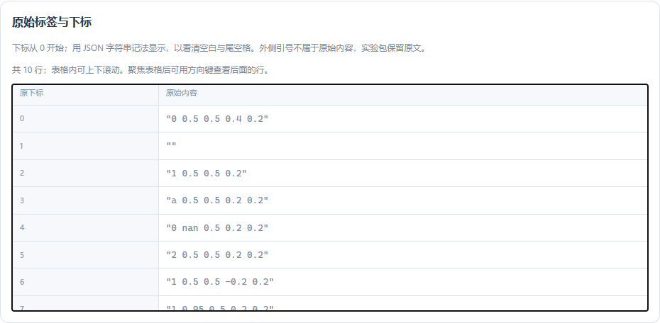
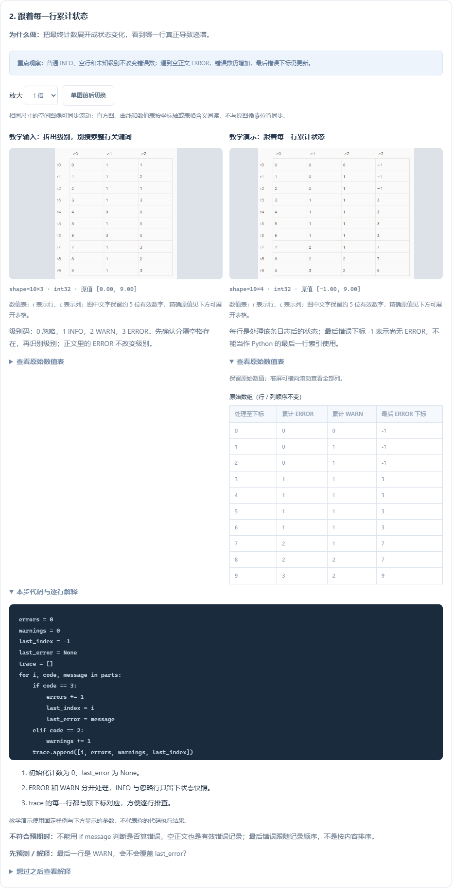
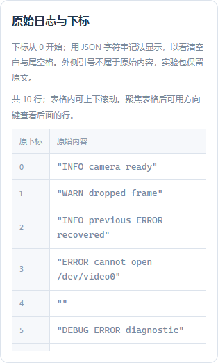

# 0.16.0：从原始文本定位标签和日志问题

新增 **Y01 YOLO 标签检查、L01 从日志定位异常** 两道逐步图解，共 7 步、6 组参数配置。图解累计覆盖 **41 / 44 道基础题、119 步、125 组参数配置**。

本版在这两题中直接展示“原始文本与下标”，让数值表里的行号能对应到实际输入。下标从 0 开始；空白行保留。为看清尾空格，用 JSON 字符串记法显示，外侧引号不属于原文，实验包保留完整原始字符串。

原文表显示总行数，可在表格内滚动；键盘聚焦滚动区后也可查看后面的行。不要把当前可见行数误认为全部输入。

## Y01：先解析，再检查含义

每行约定为 `class cx cy width height`。本题要求类别为有效整数、坐标为有限数值、宽高为正、整个框位于 [0,1]，边界允许 1e-9 的数值容差。

| 步骤 | 输出与观察重点 |
| --- | --- |
| 1. 字段解析 | 原下标、字段数、解析状态；区分空白、字段不足、非数值、非有限值和解析通过 |
| 2. 语义检查 | 分别查看类别、尺寸和边界标志；三个都通过才合法 |
| 3. 汇总坏行 | 按原下标返回非法行列表，并给出检查分支产生的原因 |
| 4. 绘制通过的框 | 观察中心/宽高如何换算到画布；不会把越界标签裁好后冒充合法输入 |

参数是三组预先准备的文本，不是自动修复你写的代码：

| 修复阶段 | 本例非法行下标 |
| --- | --- |
| 0：原始错误 | `[2,3,4,5,6,7,9]` |
| 1：只修复格式和非有限值 | `[5,6,7,9]` |
| 2：全部修复 | `[]` |

先手算原始第 7 行：中心 x=0.95、宽=0.2，右边界为 1.05，所以中心虽然在图内，整个框仍越界。再看第 9 行：类别 0.5 能转成浮点数，却不是合法整数类别。

没有非法行时显示 0×1 空表，原题返回空列表；不要用 `[0]` 代表“没有错误”。标签通过这些规则，也不证明它标对了物体或对应了正确图片。画布是坐标示意，不是真实图像标注质量评估。

## L01：级别与正文分开读

本题用第一个普通空格分开级别与正文，按约定识别 INFO、WARN、ERROR；空行、没有分隔符或未知级别的行忽略。

| 输入例子 | 应怎样处理 |
| --- | --- |
| `INFO previous ERROR recovered` | INFO；正文含 ERROR 不计错误 |
| `DEBUG ERROR diagnostic` | 未知级别，忽略 |
| `ERROR` | 没有分隔空格，忽略 |
| `"ERROR "`（外侧引号仅显示用） | 一条错误，正文是空字符串 |
| `ERROR codec failed` | 一条错误，正文为 `codec failed` |

三步依次展示：解析状态表、逐行累计状态、最终计数与最后错误。不要先 `strip()` 整行，否则会丢掉 `ERROR ` 的尾空格，改变输入含义；也不要用 `if message` 判断是否算错误。

| 样例 | ERROR 数 | WARN 数 | last_error |
| --- | --- | --- | --- |
| 0：没有错误记录 | 0 | 1 | `None` |
| 1：最后错误正文为空 | 2 | 2 | `''` |
| 2：再追加一条错误 | 3 | 2 | `'codec failed'` |

辅助表中的最后错误下标 `-1` 表示尚未遇到 ERROR，不是让你用 Python 的 `lines[-1]`。原题 `last_error` 应返回正文字符串或 None，不返回下标，也不包含级别前缀。

这仍是离线解析练习，可在 Windows 中完成；它不会连接终端、读取真实 Linux 日志或自动判断设备根因。实际排查还需要时间、进程、退出码和上下文。

## 手敲、导入与记录

1. 对照原文与下标，先预测当前行的检查结果。
2. 在 VS Code 打开分步文件，或下载实验包到已有 Python 环境。
3. 在 `practice.py` 中实现一小步，取消该步保存数组的注释后运行。
4. 导入 `results.zip`，核对真实保存的数值表与差异；未执行步骤不会自动填充。
5. 回到原题编写 `solve`，按原约定返回坏行列表或日志结果字典，再正式验收。

实验包的 `params.json` 保留原文。数值表中的状态码、下标和计数是解释工具；其中日志最后正文应通过原文与自己的 Python 变量核对。图解导入本身不验收字符串返回值，也不授予通关。

参数、观察笔记、步骤与导入结果按现有机制保存；旧 39 道图解定义保持一致。剩余 **T10、T14、A06** 三题仍使用函数讲解、提示与正式练习。

## 资料与范围

- [Ultralytics 检测数据格式](https://docs.ultralytics.com/datasets/detect/)：查看 class、中心和宽高的归一化格式；本题的完整边界检查按课程约定执行。
- [Python 字符串 partition](https://docs.python.org/3/library/stdtypes.html#str.partition)：查看首次分隔、剩余正文和找不到分隔符时的返回值。

链接于 2026-11-02 核对，线上文档版本可能变化；项目环境继续使用现有锁文件。本版没有新增依赖，也没有把功能测试当作初学者学习效果的对照试验。

[目标路线](目标路线与进阶起步指南-0.14.0.md) · [本版验收](验收记录-0.16.0.md)
