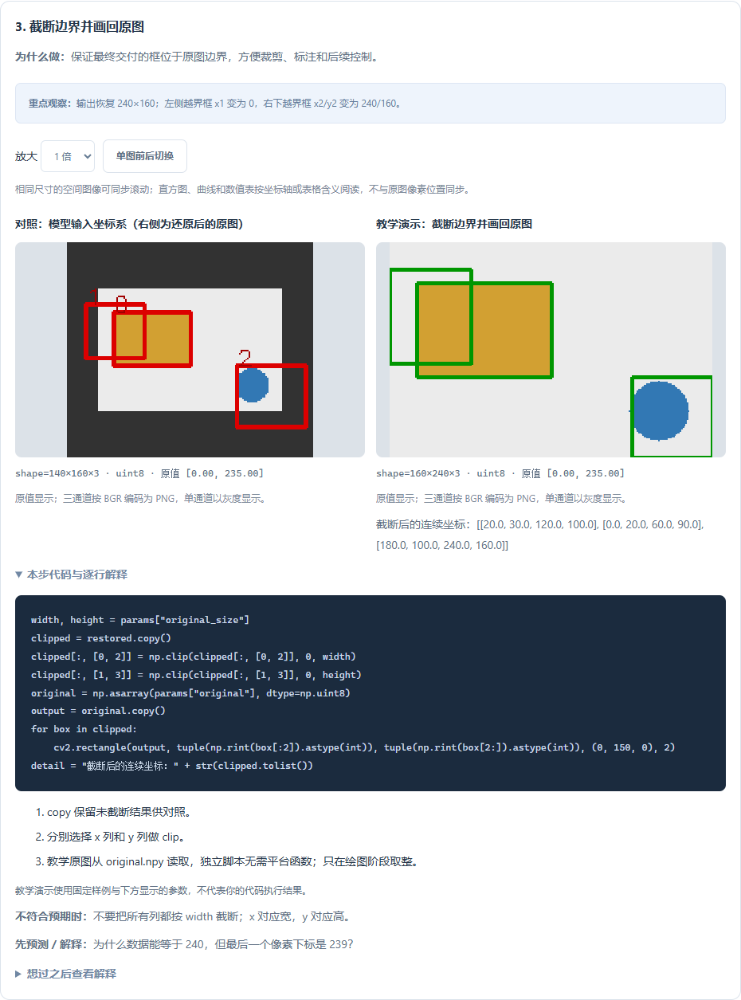
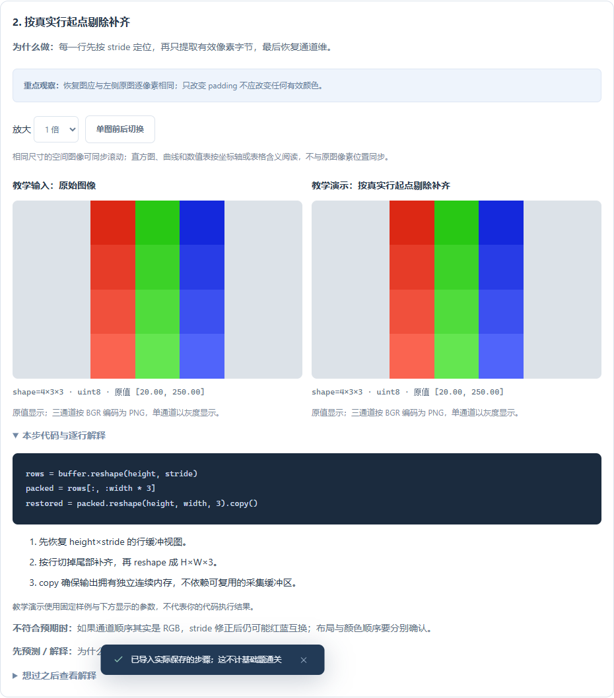

# 0.12.0：从处理图像走向检测评价与部署基础

新增 **Y02、Y03、Y04、Y05、L02、L03**，共 6 题、19 步。累计 **37 / 44 道基础题、103 步、113 组参数配置**。原有 31 题的定义与进度修订标识保持兼容；剩余 T10、T11、T13、T14、A06、Y01、L01 保留已有讲解与验收。

## 怎样开始

在基础练习中勾选“只看有逐步图解的题”，选择题目后进入“逐步图解”。先说出本步输入和期望变化，再运行改参实验，最后切到“分步手敲”。

| 学习方向 | 建议顺序 | 本轮重点 |
| --- | --- | --- |
| 检测坐标与评价 | P02 → Y02 → A04 → A05 → Y03 → Y05 | 坐标系、IoU、重复框、错类与漏检 |
| 数据准备 | Y04 → 原有 Y01 练习 | 同来源数据跨集合，标签与元数据检查 |
| 采集与性能 | P02 → L02 → L03 | 有效行字节、内存副本、阶段耗时、尾部延迟 |

这些是无需 GPU、无需开发板的确定性小实验，不执行 YOLO 训练，也不表示真实 Linux 相机或板端部署已经完成。

## 六个实验要看什么

| 题目 | 中间结果 | 关键观察 |
| --- | --- | --- |
| Y02 坐标还原 | 模型输入框 → 未截断原图坐标 → 原图叠加 | 改变缩放比例，模型坐标变化；正确还原后原图框不变。先减补边，再除比例。 |
| Y03 Precision/Recall | 样本预测表 → 混淆矩阵 → 指标表 | 阈值 50 时两指标均 0.5；90 时 Precision=1、Recall=0.25，仍漏掉三个正例。 |
| Y04 分组泄漏 | 样本/组/划分表 → 各组计数 → 问题组 | 同一组多张图都在 train 不算跨划分；同时在 train/val 才会被本题检查指出。 |
| Y05 检测匹配 | 类别与框叠加 → IoU 矩阵 → 匹配记录 → TP/FP/FN | 先按分数，再限制同类别和未占用真值。阈值 50/60 的总计数相同，但匹配过程不同。 |
| L02 行步幅 | 故意错误重排 → 正确恢复 → 布局检查 | padding=0 会掩盖错误；有补齐时必须按 stride 定位每行，只读取有效字节。 |
| L03 耗时统计 | 阶段表 → 逐帧总时间 → 均值/P95/FPS | 默认均值 29.75ms，P95 57.5ms，串行估算约 33.61FPS；这不是硬件实测性能。 |

每一步提供原因、原生代码、解释、观察点、错误排查和预测题。Y02/ L02 的左右图明确标注对照关系；原始坐标与显示时取整分开处理。

## 数值表现在怎样阅读

新题的矩阵步骤在“查看原始数值表”中增加中文列名，例如“预测索引 / 分数 / 可用最佳真值 / IoU / 匹配标志”。图片预览仍使用 c0、c1 等短索引，具体含义可与下方表头对应。混淆矩阵的行含义在重点观察中注明：行是真实标签，列是预测标签。

导入自己的数组后，同样保留对应表头；如果列数不符合本步约定，不强行套用列名。空结果仍显示 0 行和表头，不伪造成一行零。原始浮点值可能显示为 `57.49999999999997`，这是浮点表示误差；图中缩短的小数仅用于预览。

手机中可以横向滚动原始表格，也可以放大预览图。已有题目仍按原来的列含义说明阅读。

## 在 VS Code / PyCharm 手敲

1. 选择参数后，在 VS Code 点击“在 VS Code 打开分步代码”；网页用户下载实验包并解压。
2. 使用已有 Python 环境打开 `practice.py`。只使用 Python、NumPy、OpenCV，不增加本版依赖。
3. 每完成一步，取消对应保存语句的注释，运行得到 `results.zip`。
4. 读取或导入结果，查看数值差异；需要时跳到首个有差异的步骤。
5. 回原题做多样例验收，确认实现能处理其他输入。

Y02 的 `original.npy` 是还原后叠加标注所用的原图，随实验包提供，用原生 `np.load(..., allow_pickle=False)` 读取；输入与附加原图的标识随结果上下文核对。不要删除附加素材，也不要只复制 `.py` 后期待素材路径仍有效。

VS Code 已有实验代码会保留。观察笔记、参数、模式和位置仍本机记忆。导入数组与差异统计属于运行记录；个人 Python 代码另行用 Git 或文件备份。阅读、导入和自评不直接授予通关。

## 常见误解与适用边界

- Y02 使用连续 xyxy 坐标，边界可以等于原图宽高；图像最后一个像素下标则是宽高减一。真实模型必须使用其实际预处理比例和补边量。
- Y03 是二分类样本指标。Y05 才做检测框一对一匹配，但仍不是完整 AP/mAP 实现。
- Y04 只审计给定 group 字段；未发现跨集合组不能证明没有近重复图片或其他泄漏。
- L02 中 `stride` 以字节为单位。图像连续和拥有独立副本是两件事，`copy()` 用来避免输入缓冲复用时覆盖输出。这里只模拟 BGR uint8 数据。
- L03 的 P95 显式使用线性插值。串行 FPS 是平均耗时的倒数，不是逐帧 FPS 的平均；流水线并行吞吐需要另外测量。

## 官方查阅资料

- [NumPy 数组 strides](https://numpy.org/doc/stable/reference/generated/numpy.ndarray.strides.html)：理解跨维度的字节偏移。
- [NumPy percentile](https://numpy.org/doc/stable/reference/generated/numpy.percentile.html)：核对分位数与插值方法。
- [scikit-learn 分类评价指标](https://scikit-learn.org/stable/modules/model_evaluation.html#precision-recall-f-measure-metrics)：理解 Precision 与 Recall；本题不要求安装 scikit-learn。
- [scikit-learn 数据泄漏说明](https://scikit-learn.org/stable/common_pitfalls.html#data-leakage)：理解训练与评估的信息边界。

以上链接于 2026-10-30 核对；stable 文档版本可能变化，本项目运行版本以依赖锁文件为准。
