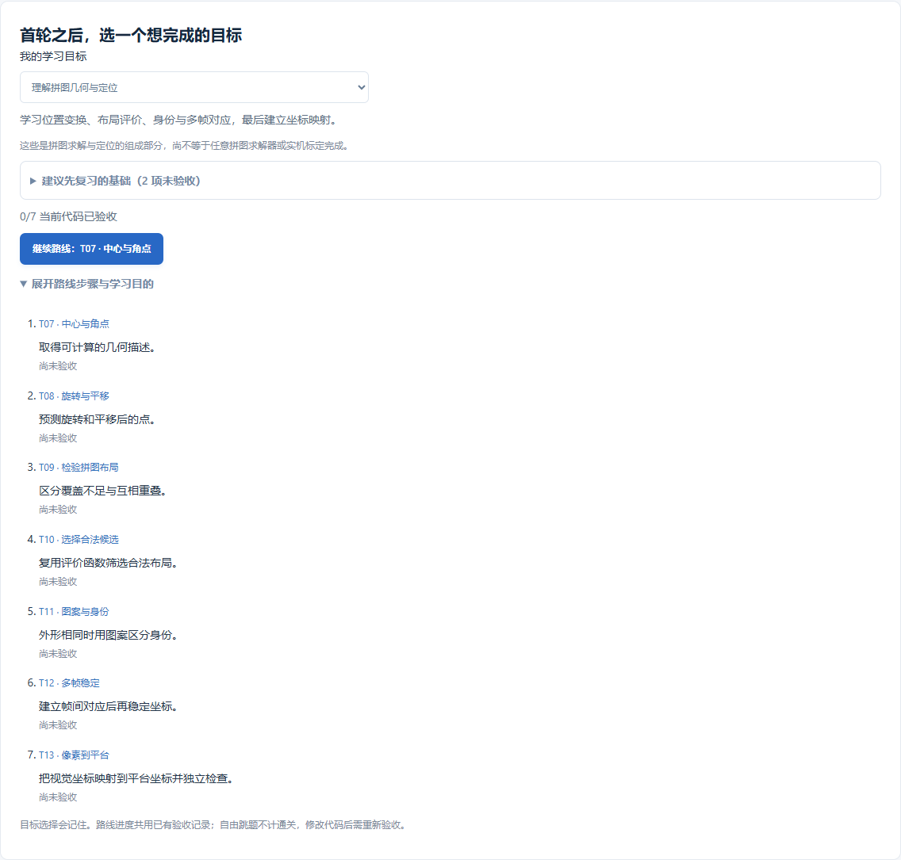

# 0.14.0：首轮之后，围绕一个目标继续学

本版补齐“八道入门题之后做什么”：新增四条短路线，T07–T14 八张起步卡，以及六个几何与组合编程术语。当前共 **16 张起步卡、24 个术语解释**。题目仍为 44 道基础题、9 个工程项目；37 道图解与 103 个步骤保持不变。

## 按目标选路线

首页“首轮之后，选一个想完成的目标”提供四个选择。刚接触视觉时，先完成上一版的首轮八题；之后一次选一个目标，不需要同时学完所有方向。

| 目标 | 顺序 | 完成后检查什么 |
| --- | --- | --- |
| 第一个碎片检测器 | T04 → T05 → T06 → T07 → T14 | 能否解释 mask 和 pieces 分别来自哪一步；空场景是否返回空列表 |
| 拼图几何与定位 | T07 → T08 → T09 → T10 → T11 → T12 → T13 | 能否分清坐标变换、布局评价、身份匹配、帧间对应和坐标标定 |
| YOLO 数据与后处理 | Y01 → Y04 → Y02 → A04 → A05 → Y03 → Y05 | 标签、划分、框坐标、去重与误报漏报是否都说得清 |
| 嵌入式视觉数据准备 | L01 → L02 → L03 | 能否从日志级别、行缓冲区和逐帧耗时找出数据问题 |

这是围绕已有题目的建议学习顺序。路线允许自由跳转，不用强制解锁；“建议先复习的基础”会列出尚未验收的准备题。已通过的步骤仍可以回看。

## 进度、前后题与记忆

- “继续路线”选择所选路线中第一道当前代码尚未验收的题。它可能位于正在学习的题之前，这是在提醒补齐未验收步骤。
- “上一题 / 下一题”按路线顺序跳转，与“继续路线”含义不同。最后一步不生成不存在的下一题。
- 路线面板位于原题工作区下方；在“任务”标签中查看。图解、函数、笔记等标签仍按原有方式操作。
- 所选目标通过现有视图记忆保存；网页版保存于当前浏览器，VS Code 保存于当前学习工程的扩展视图状态。它不是新增的跨设备账户同步功能。
- 路线进度复用现有代码验收成绩。打开题目、导入图解或选择目标均不授予通关；修改代码后需要重新验收。
- 通过路线离开练习时先执行原有保存流程。保存失败时停留当前题并提示重试；不应在错误未处理时强制刷新。
- 路线全部通过后显示完成说明，可回看或换目标；未知旧目标值会回退到有效路线。

## T07–T14：先做一个小实验

| 题目 | 第一件事 | 常见混淆 |
| --- | --- | --- |
| T07 | 先检查单条轮廓的 m00，再算质心 | 边界点平均值不总是面积质心 |
| T08 | 手算点 (1,0) 旋转 90 度，再加平移量 | 度和弧度；矩阵乘法与逐元素乘法 |
| T09 | 比较一片、两片重复覆盖时累计图的 0/1/2 | 覆盖只看目标内，重叠看全画布 |
| T10 | 单独查看一个候选通过自己的 T09 得到的两个指标 | 返回候选下标；无解返回 -1 |
| T11 | 对一个模板比较四种直角旋转的误差 | uint8 相减下溢；本题不解决任意姿态 |
| T12 | 先核对两帧中相同位置是否代表同一个对象 | 排序对应仅适用于本题静止、分离、无漏检条件 |
| T13 | 写出 [u,v,1]，检查是否共线，再用独立点验证 | 拟合点多不一定信息足够；方向是视觉到平台 |
| T14 | 先接 T04→T05，看中间掩膜，再接轮廓与几何 | 前置代码未完成；T07 所需 contours 没放入子参数 |

以上内容对应每题的输入输出与自查重点。术语库新增质心、弧度、仿射映射、矩阵的秩、建立对应关系、前置题与复用，可在本题直接搜索。

## 原生函数与平台适配接口

OpenCV/NumPy 的算法调用继续使用原生库。现有组合题 T10、T14 中的 `student(...)` 是平台用于调用已保存练习的适配接口，**不是 OpenCV 函数**。本版讲解明确这一区别，没有改变现有题目接口或覆盖已有代码。

独立工程中，应把已经写好的实现放到自己的普通 Python 模块中，导入并调用函数；例如检测流水线依次调用颜色分割、清理、轮廓和几何描述函数。先检查各函数的输入输出能否接上，再组织完整工程。

## 能力范围与资料

四条路线使用已有离线题目；完成路线不等于完成任意拼图求解、真实模型训练、完整 mAP 评测或开发板联调。真实图像、光照与设备仍需独立验证。功能测试验证了导航、保存和进度，没有开展初学者学习效果对照试验。

本轮参考官方资料（2026-11-02 核对）：

- [OpenCV 轮廓特征](https://docs.opencv.org/4.x/dd/d49/tutorial_py_contour_features.html)：对照 T07 的图像矩、面积和多边形近似。
- [NumPy 最小二乘](https://numpy.org/doc/stable/reference/generated/numpy.linalg.lstsq.html)：对照 T13 的输入矩阵、解、秩和残差；线上文档版本可能高于项目锁定环境。

[首轮八题指南](新手起步与排查指南-0.13.0.md) · [完整函数指南](函数学习指南-0.8.0.md) · [本版验收记录](验收记录-0.14.0.md)
