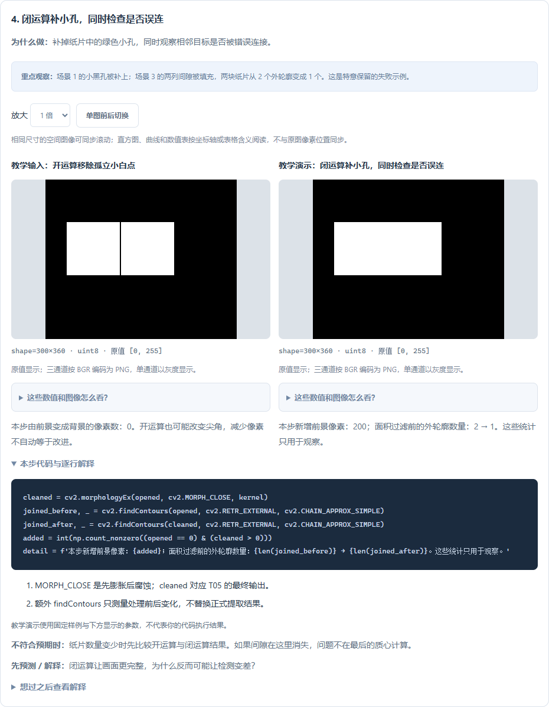
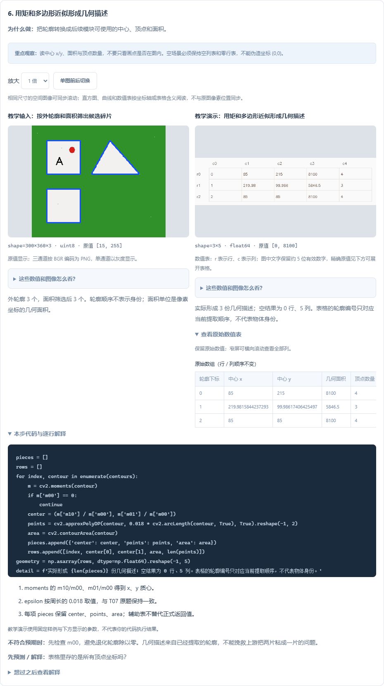

# 把四道练习接成一个碎片检测器

0.19.0 为 **T14 我的碎片检测器** 增加七步图解和四组输入。平台累计 **43 / 44 道基础题有图解、131 个步骤、133 组参数配置**。

从 **基础练习 → T14 → 逐步图解** 进入，也可以在首页选择“碎片检测”目标路线。建议先完成 **T04 → T05 → T06 → T07**，再学习组合。每一步都展示真实 OpenCV 结果，并支持手敲、运行、导入中间数组和记录观察。

## 四种场景，不只看成功样例

| 场景参数 | 输入 | 已知独立纸片数 | 固定流程检出数 | 学习重点 |
| --- | --- | --- | --- | --- |
| 0 干净 | 绿色工作台、三块纸片，含黑字和红图案 | 3 | 3 | 认识接口与正常输出 |
| 1 杂点与小孔 | 增加浅色孤立点和纸片内绿色小孔 | 3 | 3 | 分清开运算删除什么、闭运算填补什么 |
| 2 空场景 | 只有工作台和几个浅色杂点 | 0 | 0 | 掩膜全黑、轮廓与几何列表为空是合理结果 |
| 3 相邻误连 | 两块纸片之间仅隔两列背景像素 | 2 | 1 | 找到闭运算把两片连起来的具体步骤 |

颜色阈值、3×3 核和最小面积保持固定，仅改变输入场景。`expected_pieces` 是作者构造场景时已知的数量，只用于讲解，不参与分割、过滤、几何计算或结果绘图。

**场景 3 是明确保留的失败示例。** 即使自己的数组与演示全部一致，也只是复现了这个固定流程，不能证明已经解决相邻碎片检测。



## 七步的输入、输出和原生函数

| 步骤 | 主要函数 | 实际输出 | 先看什么 |
| --- | --- | --- | --- |
| 1 选择绿色背景 | `cvtColor`、`inRange` | `background`：白色是背景 | 通道顺序、阈值含义 |
| 2 取反得到前景 | `bitwise_not` | `foreground`：白色是纸片及杂点 | 黑字、红图案是否仍属于纸片 |
| 3 开运算 | `morphologyEx(..., MORPH_OPEN, ...)` | `opened` | 孤立白点消失；尖角也可能改变 |
| 4 闭运算 | `morphologyEx(..., MORPH_CLOSE, ...)` | `cleaned` | 小黑孔补上，同时检查间隙是否消失 |
| 5 提取与筛选轮廓 | `findContours`、`contourArea` | `contours`，另保存轮廓叠加图 | 外轮廓数量与面积过滤 |
| 6 形成几何描述 | `moments`、`arcLength`、`approxPolyDP` | `pieces`，另保存五列观察表 | 中心、几何面积、顶点数量 |
| 7 组织交付 | 普通字典、`polylines`、`drawMarker` | `result={'mask':cleaned,'pieces':pieces}`，另保存叠加图 | 返回完整数据，检查场景预期 |

步骤 1–2 对应 T04，步骤 3–4 对应 T05，步骤 5 对应 T06，步骤 6 对应 T07。最后组合返回结构。

HSV 阈值必须应用在转换后的 HSV 图上；标准 8 位 HSV 的 H 为 0～179，S/V 为 0～255。[OpenCV 颜色空间教程](https://docs.opencv.org/4.13.0/df/d9d/tutorial_py_colorspaces.html)。开运算先腐蚀再膨胀，闭运算先膨胀再腐蚀；它们按照结构元素处理形状，不能理解物体身份。[OpenCV 形态学教程](https://docs.opencv.org/4.13.0/d9/d61/tutorial_py_morphological_ops.html)。

## 第一次手敲，按三个小目标完成

1. **先完成前景**：写步骤 1–2，运行并导入。确认绿色台面为黑、纸片内黑字仍为白，再继续。不要直接凭叠加图判断。
2. **再完成干净掩膜**：写步骤 3–4。切到带噪场景，看小白点和小黑孔的变化；切到相邻场景，找出间隙首次消失的位置。
3. **最后完成几何交付**：写步骤 5–7，读表格和完整 `pieces`，再回原题实现组合并验收。

在 VS Code 点击“打开分步代码”，或下载实验包使用已有 Python 环境。每完成一步，取消该步三行数组保存代码的注释，保存并运行 `practice.py`，再读取 / 导入 `results.zip`。可只写前几步；检查清单会显示哪些步骤尚未保存。

原题中的 `student('T04', ...)` 等调用是平台适配接口，只会执行你已保存的前置实现；它不是 OpenCV 函数。独立实验包已经展开原生操作，不依赖 `student` 或平台模块。独立工程应导入自己的模块并调用普通函数。

## 为什么先定位掩膜，而不是最后调质心

| 观察到的现象 | 先检查 | 原因 |
| --- | --- | --- |
| 台面被当作大目标 | 步骤 1–2 | 背景阈值、BGR/HSV 或取反方向可能错误 |
| 黑字被挖成孔 | 步骤 1–2 | 可能额外按亮度删掉了本属前景的文字 |
| 小白点成为碎片 | 步骤 3、5 | 清理或面积过滤未满足当前场景 |
| 两片变成一片 | 步骤 3–4 对照 | 间隙可能被闭运算填掉，调质心不能拆开轮廓 |
| 空图仍有中心 (0,0) | 步骤 5–6 | 可能错误地为“没有轮廓”生成了默认记录 |
| 输出图好看但原题失败 | 步骤 7 与原题契约 | 原题需要完整字典与顶点，不是图片或辅助表格 |

如果闭运算误连，可以在独立实验中尝试更小结构元素、调整处理顺序或寻找区域分离方法，但必须同时回测带孔、带噪和空场景。不要因为一个输入变好就断言修改普遍有效。本版没有自动分离粘连区域。

## 几何表怎样读



五列依次是 **轮廓下标、中心 x、中心 y、几何面积、顶点数量**。轮廓编号来自当前提取顺序，不代表稳定身份；完整顶点坐标保存在 `pieces`，不在这张简化表里。

质心用 `m10/m00` 和 `m01/m00`，必须先排除 `m00 == 0`。本题返回中心保留浮点精度，只在绘图时取整。`contourArea` 的几何面积不等于掩膜非零像素数，例如覆盖 11×11 个像素的矩形，其边界角点相距 10，轮廓几何面积是 100。[OpenCV 轮廓特征教程](https://docs.opencv.org/4.13.0/dd/d49/tutorial_py_contour_features.html)。

空场景的几何表是 `(0, 5)`，没有最小值和最大值；正式 `pieces` 是 `[]`。这与一行全零数据不同。结果导入只比较保存的数值数组，不会自动验收未保存的完整字典，仍需回原题验收。

## 独立实验：复现误连，再看是哪一步造成的

下面代码只依赖 NumPy 与 OpenCV，可在 VS Code 或 PyCharm 的普通 Python 文件运行。它是单独的理解实验，不要拿它生成的数组冒充平台固定实验包的结果。

```python
import cv2
import numpy as np

mask = np.zeros((300, 360), dtype=np.uint8)
mask[80:180, 40:140] = 255
mask[80:180, 142:242] = 255  # 中间两列 140、141 仍为 0
kernel = np.ones((3, 3), dtype=np.uint8)
opened = cv2.morphologyEx(mask, cv2.MORPH_OPEN, kernel)
closed = cv2.morphologyEx(opened, cv2.MORPH_CLOSE, kernel)

before, _ = cv2.findContours(opened, cv2.RETR_EXTERNAL, cv2.CHAIN_APPROX_SIMPLE)
after, _ = cv2.findContours(closed, cv2.RETR_EXTERNAL, cv2.CHAIN_APPROX_SIMPLE)
print('外轮廓数量：', len(before), '→', len(after))
assert len(before) == 2 and len(after) == 1
assert np.all(opened[100, 140:142] == 0)
assert np.all(closed[100, 140:142] == 255)
```

先预测，再把核改为 1×1，或把两片间隙加宽，并根据预测修改断言。记录：哪一段边界发生了变化、目标数量怎样变化、这种修改对其他场景是否也合适。

## 回到原题完成验收

先确认自己的 T04、T05、T06、T07 能分别通过正式检查，再实现 T14 的组合。T07 需要的轮廓放入复制后的 `child['contours']`；传给清理和轮廓提取的是掩膜，传给最终几何模块的参数包含轮廓列表。

图解导入不会证明前置题已经写对，也不会自动获得原题成绩。T14 检测完成不等于模型训练、实时相机或机械闭环完成。本轮保留原有 42 道图解定义与记录，剩余 A06 尚未提供逐步图解，仍有原题讲解和验收。

已有插件执行 **Vision: 检查插件更新**；首次安装见 [Releases](https://github.com/CaoYujie-code/VisionLearningHub/releases)。官方资料核对日期：2026-11-03；项目依赖以锁文件为准。

[本版验收记录](验收记录-0.19.0.md) · [手机端交付说明](images/detector-mobile-0.19.0.png)
