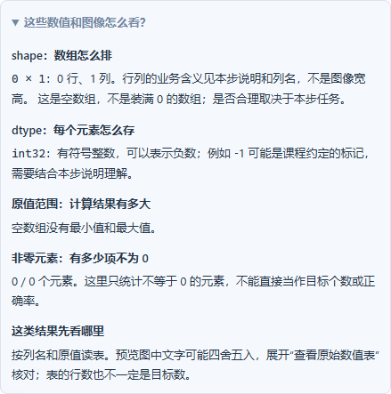

# 看懂结果，再定位下一步

0.17.0 面向“图已经出来了，但不知道它说明什么”的学习阶段。入口是 **基础练习 → 逐步图解**，适用于已有 41 道图解、119 个步骤和 125 组参数配置。本版优化共用学习界面，没有增加题目或改变课程定义。

## 一次只完成一小步

以 T03 阈值分割为例：

1. 选择参数 130，先看灰度图和阈值结果，预测哪些位置会变成白色。
2. 在 VS Code 打开分步代码，或下载实验包，用自己的 Python 环境打开 `practice.py`。
3. 先写第一步的灰度转换，取消本步保存数组的三行注释；第二步先保留 TODO。保存并运行文件，再读取 / 导入 `results.zip`。
4. 在“我的结果：下一步检查哪里”查看状态。第一步可能一致，第二步应显示“未保存”。点击“查看首个未保存步骤”会切到第二步，并把页面和键盘焦点移到讲解。
5. 写完第二步，重新运行并导入。若出现差异，点“查看首个待检查步骤”，对照形状、数据类型、首个差异索引，再检查运算。
6. 全部数组一致后换一组参数，解释变化。最后点“独立挑战：回到原题”，完成 `solve` 返回值并通过正式多样例验收。

分步脚本使用原生 Python、NumPy、OpenCV。每次执行重新生成结果包；清单反映最近一次导入，不会实时监听你尚未运行的代码。VS Code 中也要依次保存、运行、读取结果。


## 每种状态该做什么

| 状态 | 现在能确定什么 | 下一步 |
| --- | --- | --- |
| 尚未导入 | 平台没有你的数组 | 先运行一小步，再导入 |
| 未保存 | 最新结果包缺少该步数组 | 检查处理代码、保存代码是否仍被注释，以及程序是否提前报错 |
| 暂不能比较 | 尺寸、类型或统计条件不满足 | 先读提示，核对数组约定，不要直接强转类型来消除提示 |
| 存在数值差异 | 本次样例有元素超出容差 | 看首个差异索引，检查输入、参数和运算；差异本身不是原因诊断 |
| 尚无数值比较 | 记录中没有比较信息 | 重新运行并导入，不能把缺少信息视为一致 |
| 本次样例数值一致 | 当前数组在既有比较容差内一致 | 换输入，并回原题验证完整返回值 |

参数不一致时暂不比较，可以在下方导入区切换到导入参数；课程修订过期时重新生成实验包。双方为空数组时会明确提示还需要检查有结果的输入。状态与原题成绩分开，参考代码生成的结果也不能证明你独立完成。

## 图下的数字怎么读

展开 **“这些数值和图像怎么看？”**，说明根据该张真实数组生成：

- `shape`：数组各轴长度。例如空间图像 `(240, 400, 3)` 是 240 行、400 列、3 个通道；数组索引用 `[行, 列]`，OpenCV 点坐标通常用 `(x, y)`。数值表按行列业务含义阅读，不能套用图像宽高。[NumPy shape 文档](https://numpy.org/doc/stable/reference/generated/numpy.ndarray.shape.html)、[OpenCV 图像基本操作](https://docs.opencv.org/4.13.0/d3/df2/tutorial_py_basic_ops.html)。
- `dtype`：每个元素的存储类型。`uint8` 的类型范围是 0～255；`float32` 不自动限定为 0～1。颜色空间与任务语义还要看代码，三通道不自动等于 RGB。
- 原值范围：本次计算数组的最小值、最大值。预览可能经过显示映射；小的非零数现在不会因为固定两位小数而显示成零。科学计数法 `1e-7` 表示 `0.0000001`。
- 非零元素：统计元素不等于 0 的数量。三通道各通道分别计数；直方图中统计的是有计数的灰度级；标签图中统计非背景元素。不能直接把这些数字当成物体数量。[NumPy count_nonzero 文档](https://numpy.org/doc/stable/reference/generated/numpy.count_nonzero.html)。

`shape=(0, 1)` 的表是零行、一列，没有最小值和最大值；它与 `(3, 1)` 且全为零的表不同。前者可能表示“没有发现非法标签”，后者可能是三个值恰好都是零，必须结合本步契约判断。



## 八种预览，八种观察方式

| 预览 | 先看什么 | 别误读成什么 |
| --- | --- | --- |
| 图像 | 空间位置、通道含义、显示转换 | 三通道必定是 RGB |
| 正负数据图 | 符号及变化方向 | 物体的真实颜色 |
| 幅值图 | 原始数值大小与单位 | 预览亮度就是原始数值 |
| 热力图 | 每张图的数值范围与缩放规则 | 不同图同色必定同值 |
| 区域标签图 | 区域编号及背景约定 | 类别或跨帧身份 |
| 直方图 | 灰度位置、计数与坐标轴尺度 | 峰高可以跨图直接比较 |
| 映射曲线 | 一个输入灰度映射到什么输出 | 照片中的空间位置 |
| 数值表 | 列名与可展开的原值 | 表格行数必定等于目标数 |

不同题仍需阅读本步“重点观察”和显示说明。共用解释不是自动识别错误原因，也不能替代工程场景的验收。

## 用原生函数做一个小实验

以下是额外理解实验，不是平台正式题答案。新建 `read_array.py`，在装有 NumPy、OpenCV 的环境运行：

```python
import cv2
import numpy as np

gray = np.array([[0, 80, 130], [131, 200, 255]], dtype=np.uint8)
_, mask = cv2.threshold(gray, 130, 255, cv2.THRESH_BINARY)
print(mask)
print(mask.shape, mask.dtype, np.count_nonzero(mask))
assert mask.tolist() == [[0, 0, 0], [255, 255, 255]]
assert np.count_nonzero(mask) == 3

color = np.repeat(mask[:, :, None], 3, axis=2)
print(color.shape, np.count_nonzero(color))
assert color.shape == (2, 3, 3)
assert np.count_nonzero(color) == 9

empty = np.empty((0, 1), dtype=np.int32)
zeros = np.zeros((3, 1), dtype=np.int32)
print(empty.shape, empty.size, np.count_nonzero(empty))
print(zeros.shape, zeros.size, np.count_nonzero(zeros))
assert empty.size == 0 and zeros.size == 3
```

先预测：为什么 130 仍是黑色？为什么同样三个白色位置，复制为三通道后非零元素变为 9？为什么最后两张表的非零元素都是 0，但元素总数不同？

答案：这次二值阈值使用严格大于；三通道逐元素统计；空数组没有元素，全零数组有元素但其值都是零。把阈值改成 80，再自行更新预期并运行。

## 记录与更新

检查清单复用已有导入记录，跳转复用原有步骤位置和笔记保存；没有新建一套完成分数。刷新后恢复，导入新的空结果包会替换旧结果，不会借用旧数组补齐。

已有插件执行 **Vision: 检查插件更新**；首次安装见 [Releases](https://github.com/CaoYujie-code/VisionLearningHub/releases)。插件仍为可选安装，未上架扩展市场。网页版重新构建并启动后刷新页面。

官方链接核对日期：2026-11-02。NumPy stable 文档随上游更新，本项目依赖以锁文件为准；没有因文档版本升级项目依赖。本轮不涉及模型训练、设备连接或新题目，T10、T14、A06 仍未制作逐步图解。

[本版验收记录](验收记录-0.17.0.md) · [窄屏读数说明](images/reading-mobile-0.17.0.png)
