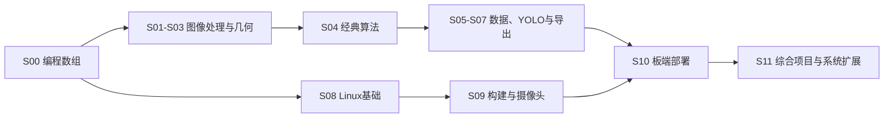

# 课程路线、适用情况与练习设计

当前 0.4.0 的实际路线已扩展至 24 章、44 题，详见 [完整学习路线](学习路线-0.4.0.md)。请先看 [实际学习路线与首次使用指南](第一次使用与学习指南.md)；下方表格保留为早期总体规划。
日期：2026-10-25。以下是拟建设课程和练习，不代表已经实现。

## 学习路线

| 阶段 | 学习内容 | 应能完成的事情 | 练习产物 |
|---|---|---|---|
| S00 编程与数组 | Python 函数、循环、文件、NumPy 索引、dtype、广播 | 读懂输入处理返回，解释数组形状 | 小函数、数组结果、中间输出 |
| S01 图像与坐标 | 像素、BGR/RGB、ROI、缩放、直方图、灰度 | 读图、裁剪、画框，并说明坐标变化 | 标注图、坐标表、直方图 |
| S02 预处理与分割 | 高斯/中值、阈值、Otsu、自适应、HSV、形态学 | 根据噪声和成像条件选择预处理 | 多种方法的对照图与实验结论 |
| S03 边缘与几何 | 梯度、Canny、连通域、轮廓、质心、多边形、透视、标定 | 从区域提取几何信息，检查尺度与误差 | 掩膜、中心角点、矫正图、标定报告 |
| S04 经典算法 | 模板、特征匹配、RANSAC 入门、IoU、NMS、对应关系、搜索 | 把视觉结果变成可计算的约束 | 匹配可视化、评分、搜索结果 |
| S05 数据与深度学习 | 张量、训练/验证、损失、过拟合、CNN、迁移学习 | 理解训练改变了什么，以及如何检验泛化 | 数据清单、曲线、小分类模型 |
| S06 YOLO 检测流程 | 标签、预训练推理、微调、预测解析、误检漏检 | 运行自己的数据流程并解释输出 | 标签预览、权重、推理结果 |
| S07 评价与导出 | precision/recall/mAP、错误分组、ONNX、输入输出约定 | 独立验证模型并比较导出前后结果 | 验证报告、模型清单、误差与延迟表 |
| S08 Linux 基础 | 文件、权限、管道、进程、环境、SSH、日志 | 在真实 Linux 环境管理和运行实验 | 命令效果、生成文件、运行日志 |
| S09 Linux 视觉应用 | C/C++、CMake、动态库、摄像头、V4L2、媒体管线 | 构建和运行读帧/推理应用，排查环境问题 | 构建产物、采集样例、诊断记录 |
| S10 嵌入式部署 | 架构与交叉编译、板卡 SDK、模型适配、量化、性能 | 在一种实际设备上跑通视觉链路 | 板端程序、设备信息、完整链路报告 |
| S11 系统与综合项目 | 启动流程、设备树、根文件系统、Buildroot；项目集成 | 说明系统组件关系并完成一个可复现实验项目 | 系统配置、实验手册、项目报告 |

编号按主题组织。S08 可以在 S00 后并行学习；S09 的 C/C++ 基础应在进入复杂摄像头例程前完成。

## 单节课的标准学习流程

1. 看一个具体问题，先预测输出。
2. 用少量图示解释原理、关键参数和适用条件。
3. 阅读输入输出约定，手算或手画一个小样例。
4. 在 TODO 中补核心代码，观察每一步中间结果。
5. 改一个变量进行对照，解释变化原因。
6. 用独立样例验收，查看失败原因。
7. 完成选型题和复盘：什么时候继续用它，什么时候换方法。

提示逐步展开；参考实现需要主动查看。看过答案的练习仍可完成，但平台提醒之后从空白复写核心函数。

## 六个重点实验样例

### 实验一：面对不同噪声，如何选择滤波

- 输入：同一张干净图、带高斯噪声图、带椒盐噪声图，噪声种子固定。
- 操作：手敲高斯、中值与可选双边滤波；控制核尺寸，每次只改一个参数。
- 观察：噪声降低、边缘模糊、短线丢失，以及已知干净图上的误差。
- 验收：接口、输出尺寸与类型、指定算子的结果；对照图与参数记录完整。
- 适用情况：噪声类型影响选择。不能把“越平滑越好”作为通用结论。
- 选型题：小纸片的短边被滤掉了，先调核尺寸还是在最后补角点，为什么？

### 实验二：颜色分割与 Canny 为什么得到不同结果

- 输入：有纹理纸片、阴影、相近颜色背景三组图片。
- 操作：实现 HSV 前景掩膜与 Canny 边缘，观察纸内文字对两种结果的影响。
- 验收：掩膜 IoU、边缘格式与几何检查分别评分，不把两种输出直接等同。
- 适用情况：需要整块面积时先构造区域；需要亮度突变位置时观察边缘。
- 失败分析：当目标与背景同色时，颜色假设可能失败，应考虑照明、纹理、几何或学习方法。

### 实验三：透视矫正后怎样检查测量是否可信

- 输入：已知角点的平面图、不同拍摄倾角、含错误点序的反例。
- 操作：建立四点对应、矫正、测量图中目标。
- 验收：点序、输出坐标、重投影或独立检查点误差。
- 适用情况：针对平面映射；不把透视变换当作镜头畸变校正或任意三维物体矫正。
- 复盘：分别解释透视矩阵、相机内参、像素到物理单位的关系。

### 实验四：YOLO 的框为什么映射回原图后偏了

- 输入：原图尺寸、缩放比例、padding、模型输入坐标中的已知框。
- 操作：手敲坐标逆变换，再在原图画框。
- 验收：长图、宽图、边界框、零 padding 与越界裁剪的独立样例。
- 适用情况：模型前后处理必须保持一致；本题不需要 GPU 或实际训练。
- 延伸：比较直接 resize 与 letterbox，解释何时会改变物体长宽比。

### 实验五：自己的模型训练过了，为什么现场仍漏检

- 输入：按采集场景分组的数据、标签与模型预测。
- 操作：检查划分，训练小模型，按照明/距离/遮挡分组验证并查看错误图片。
- 验收：数据划分与配置可追溯、训练和验证真实执行、指标报告与错误分析完整。
- 适用情况：训练曲线用于分析优化过程，独立验证与真实场景用于检验泛化。
- 复盘：区分标注错、类别不均衡、训练分布缺失、阈值选择和模型容量。

### 实验六：板端画面卡顿，到底慢在哪里

- 输入：同一段视频、同一个模型，以及目标设备环境档案。
- 操作：分别计时采集、预处理、推理、后处理和输出，记录队列长度与丢帧。
- 验收：计时边界清楚、设备/模型/输入大小固定、保存多次测量与完整日志。
- 适用情况：系统吞吐和单帧延迟不同；异步队列可能提高吞吐，也可能增加延迟。
- 复盘：先找瓶颈，再比较降低输入尺寸、减少拷贝、调整采集与模型加速的效果。

## 累计约 30 题的建设目标

以下是 M1/M2 拟建设题目；需要模型、Linux 或设备的题目会标注环境条件。

| 类别 | 数量 | 题目示例 |
|---|---:|---|
| 编程与数组 | 4 | 阈值列表筛选、布尔数组统计、dtype 与数值差、点集向量计算 |
| OpenCV | 12 | 颜色通道、ROI 坐标还原、阈值、直方图、噪声滤波、Canny、形态学、轮廓质心、多边形、透视、标定检查、模板匹配 |
| 经典算法 | 4 | IoU、NMS、对应关系与中值稳定、小网格 DFS |
| YOLO 与模型 | 6 | 标签校验、letterbox 逆变换、precision/recall、预训练推理、训练与错误分析、导出一致性 |
| Linux 用户空间 | 4 | 真实目录与权限、管道和日志、CMake 构建、进程与依赖诊断 |
| 合计 | 30 | 此数量是开发目标，不是当前已实现题数 |

Linux 四题需在真实 WSL/Linux 中提交操作结果；只有题目原理讲解和示例日志可在纯 Windows 环境阅读。

## 综合项目路线

| 项目 | 适合阶段 | 核心学习点 | 最终验收 |
|---|---|---|---|
| 彩色工件分类计数 | S03 后 | 分割、轮廓、位置、失败分析 | 多场景数量与位置检查、错误样例 |
| 透视校正与平面测量 | S03/S04 后 | 点序、标定、几何、尺度 | 独立检查点与测量误差报告 |
| 自定义物体检测 | S06/S07 后 | 数据、训练、阈值、误检漏检 | 未参与训练的独立场景表现 |
| Linux 摄像头检测应用 | S09/S10 后 | 读帧、推理、日志、应用生命周期 | 真实环境连续运行与异常退出记录 |
| 视觉拼图系统 | 基础综合项目后 | 检测、身份、约束、搜索、坐标映射 | 分模块证据和整体输入输出，机械部分单独实测 |

## 复习与评价规则

- 不用阅读时长代表掌握程度；让学习者复写关键步骤、解释参数和分析失败。
- 不把参考实现的像素或顶点顺序当作所有算法的唯一正确表达；按题目契约比较。
- 不用训练集准确率代替验证集指标，不让相邻视频帧随机混入训练与验证两侧。
- 不用模拟 Linux 操作通过代替实际系统实验；硬件缺失就显示等待设备。
- 每次实验保留代码、参数、输入清单、环境和结果。复盘能对应具体尝试记录。
