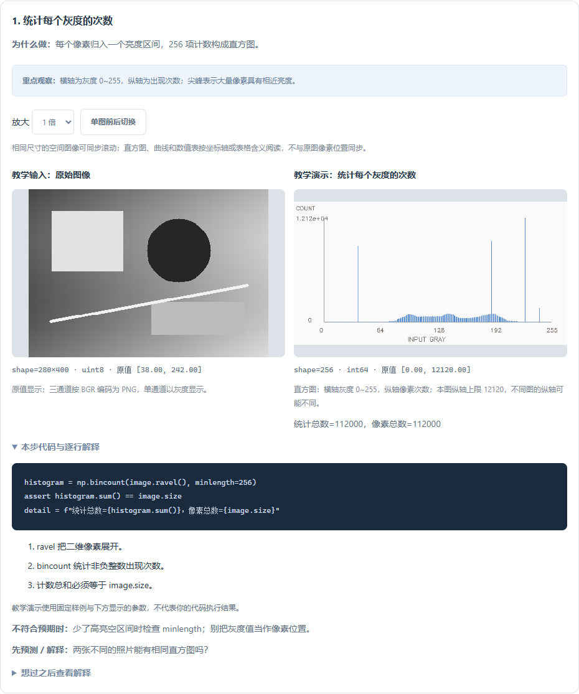
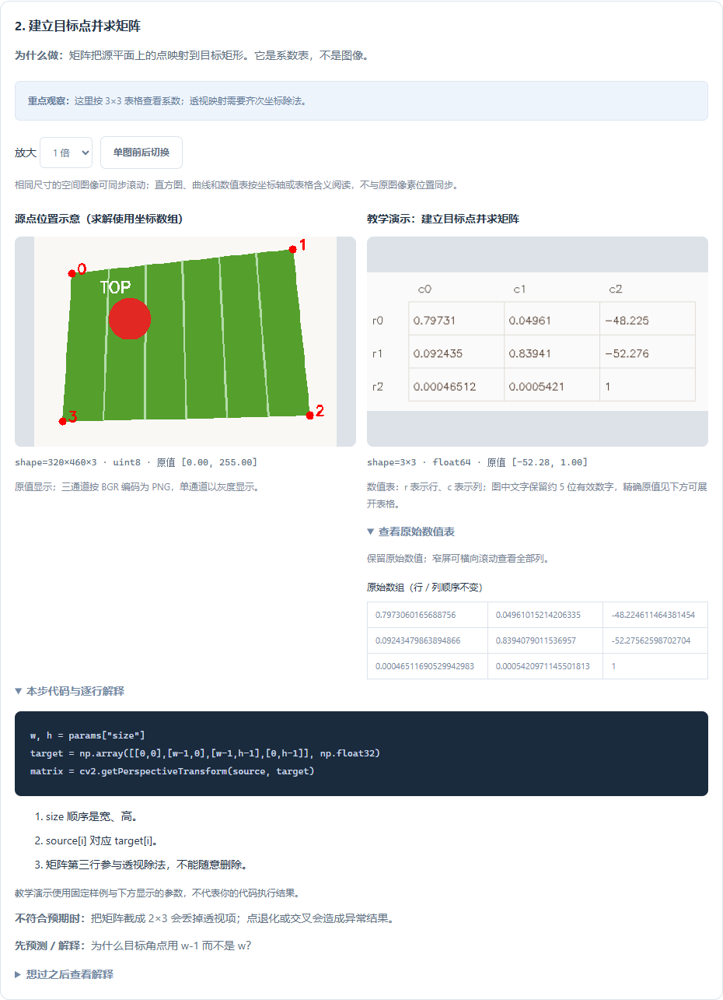

# 逐步图解扩展指南 · 0.10.0

本版新增 15 道逐步课程，累计 **23 / 44 道基础题、58 个步骤、71 组可选参数配置**。其中 **V01–V14 全部具备图解**，另外覆盖 T01–T06、A01–A03。课程与参数均可离线运行，使用 OpenCV、NumPy 和 Python 标准库，不新增依赖。

## 如何开始

在基础练习选择题目，点击“先逐步看图理解本题”，或者打开“逐步图解”标签。此前已学过的题会回到原来的标签页和步骤，不必每次从任务页开始。

推荐三条学习顺序：

- **分割与形状**：T03 → V01 → V06 → V02 → T05 → V10 → V11。
- **噪声与边缘**：A01 → V03 → V04 → A02。
- **工程图像处理**：A03 → V07 → V08 → V09 → V12 → V13 → V14。

每次先预测变化，再看图、读代码、改一个参数，最后手敲并导入自己的结果。自评记录与正式题目验收始终分开。

## 新增课程

| 题目 | 分步内容 | 参数实验与关键边界 |
| --- | --- | --- |
| A01 高斯滤波 | 平滑 → 绝对差异 | 固定 sigma 改核边长；核越大不代表细节越好 |
| A02 Canny | 灰度 → 平滑 → 双阈值边缘 | 低阈值固定，改变高阈值；边缘线不同于区域掩膜 |
| A03 透视矫正 | 四点标注 → 矩阵 → 重采样 | 正确、镜像错误和交叉错误点序对比；错误模式只供观察 |
| V01 直方图 | 灰度计数 → 空间选择 → 重排像素 | 改观察阈值不改变原始直方图；理解统计丢失位置 |
| V02 局部阈值 | 全局对照 → 自适应分割 | 改局部窗口，C 固定；均匀区域也可能变白 |
| V05 积分图 | 圈出 ROI → 累积 → 四角求和 | 移动 ROI；检查额外零边、总和与直接切片一致 |
| V06 Otsu | 直方图 → 自动阈值 → 固定阈值对照 | 固定对照参数不参与 Otsu；不能只凭双峰判断成功 |
| V07 缩放 | 面积插值 → 最近邻对照 | 25%、50%、150%；照片和标签有不同插值需求 |
| V08 Gamma | LUT 曲线 → 像素映射 | 0.5、1、2 指数；本题采用 gamma 而非 1/gamma |
| V09 CLAHE | 原始直方图 → 全局均衡 → 局部增强 | 固定网格，改 clipLimit；增强也可能放大噪声 |
| V10 连通域 | 标签 → 面积过滤 → 统计表 | 4 / 8 连通；角接触合并、背景编号与孔洞面积 |
| V11 距离图 | 精确距离 → 内部候选 | 改距离门限；距离峰不等同于独立物体 |
| V12 模板匹配 | 模板 → 响应图 → 定位框 | 裁去模板边缘；差平方取最小值，最小值不证明存在目标 |
| V13 红色环绕 | 高 H 段 → 低 H 段 → OR 合并 | 改 S 下限；灰白像素的 H=0 不代表红色 |
| V14 帧差 | 前后帧 → 绝对差 → 变化掩膜 | 改变化门限；新旧位置和光照变化都会响应 |

## 图像以外的数据怎么读

- **直方图**：横轴为输入灰度 0～255，纵轴为像素次数。不同图可采用不同纵轴上限，注意图下注明的范围。
- **Gamma 曲线**：横轴输入、纵轴输出；灰色恒等线帮助判断提亮还是压暗。界面选项 `50 / 100 / 200` 对应实际 gamma `0.5 / 1 / 2`，实际参数与选中映射值均显示。
- **矩阵与统计表**：使用表格预览，不把系数当灰度照片。可展开“查看原始数值表”查阅实际数值；手机上横向滚动查看所有列。
- **热力图**：积分和、距离、模板响应有各自的数值含义。暗紫到亮黄表示本图较低到较高值，图下显示原始范围。不同图独立缩放，不能只比颜色判断强弱。
- **标签图**：颜色是区域编号的辅助显示，背景 0 为黑色。颜色不表示类别、跨帧身份；标签很多时颜色可能重复。

上述视图保留原始数组。图表不与原图像素位置同步滚动；相同尺寸的空间图像仍支持同步滚动。

“方法对照”明确表示两种独立方法的结果比较。例如 CLAHE 从原图计算，左侧全局均衡结果只是参照，不是它的输入。请结合每一步代码确认实际使用的变量。

## 在 VS Code / PyCharm 中手敲

操作沿用[首批图解指南](逐步图解学习指南-0.9.0.md)：在 VS Code 打开分步代码，运行后读取结果；浏览器使用“下载手敲实验包”和“导入 results.zip”。

新增两类独立素材：

- V12 的 `template.npy`：要寻找的灰度模板。
- V14 的 `previous.npy`：上一帧原始图像。

脚本使用 `np.load(..., allow_pickle=False)` 读取它们，并用原生 OpenCV 函数处理。素材、参数、模板裁剪规则和当前帧都来自对应实验包。平台核对题号、版本、输入和附加素材标识，不执行上传代码。中间结果既可以是图像，也可以是一维直方图、查找表或二维矩阵。

修改参数请从平台选择后生成对应实验包，避免文件标识与实际实验不一致。平台无法仅凭导入结果证明代码独立完成，或证明本地实际运行时没有修改参数。因此导入与自评都不授予代码通关。

## 进度与兼容

首批 T01–T06、V03、V04 的课程定义和修订标识保持不变，旧步骤、笔记、自评与导入实验标识继续兼容。新增课程使用相同的 SQLite 记录、保存失败提示、跳转保护与备份恢复。

平台自动从课程目录获得覆盖列表，未覆盖的题明确提示当前范围，便于后续持续增加课程。个人手敲目录不会因升级被替换；新实验参数或课程修订使用不同目录。个人代码仍需用 Git 或自行备份。

## 还没有覆盖什么

剩余 21 道基础题尚未制作这一版逐步图解：P01–P02、T07–T14、A04–A06、Y01–Y05、L01–L03。它们仍保留原有函数讲解、提示和验收。九个工程已有任务块引导，但并未宣称全部转成逐步图解。

新样例包含固定的教学合成场景；独立脚本、正确原生调用和界面可视化不等于已经验证实物现场。继续通过正式题目的多样例验收，再将方法迁移到实际采集图像。

安装更新：已有插件执行 **Vision: 检查插件更新**。更新过程、数据清除范围和导出说明见[项目首页](../../README.md)。
